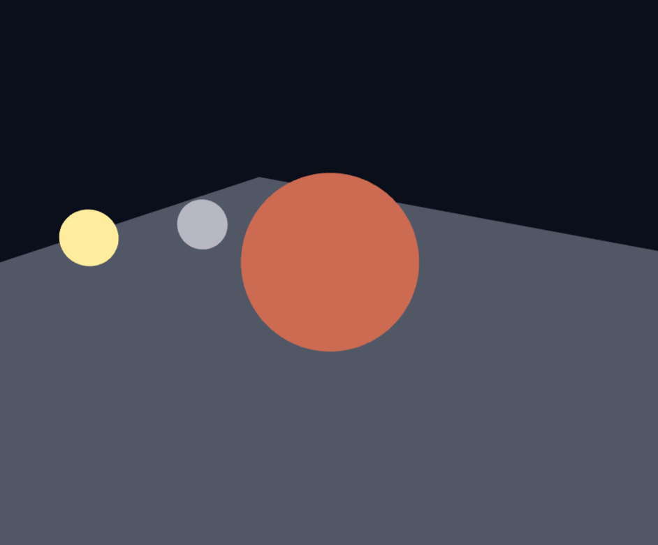
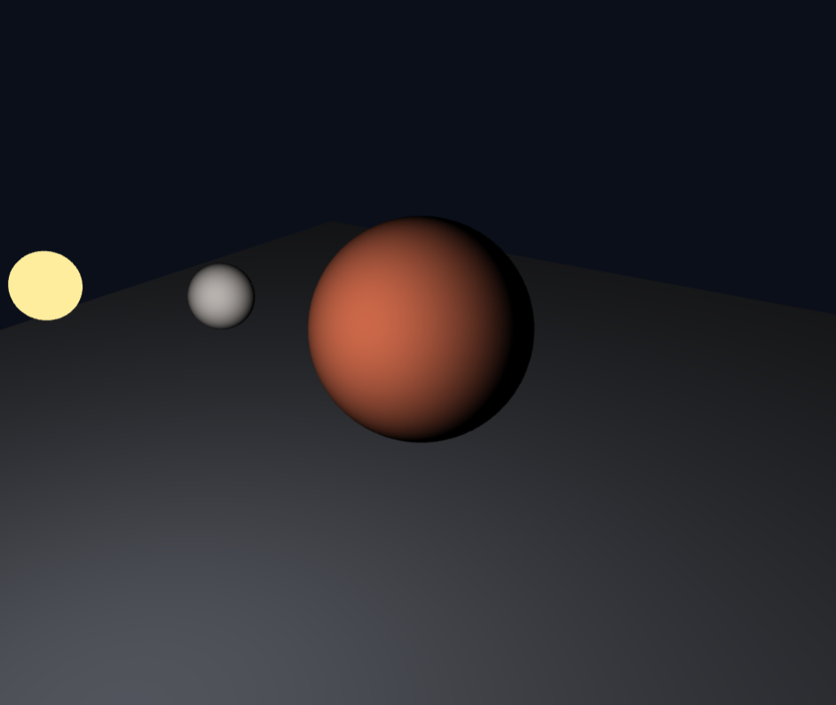
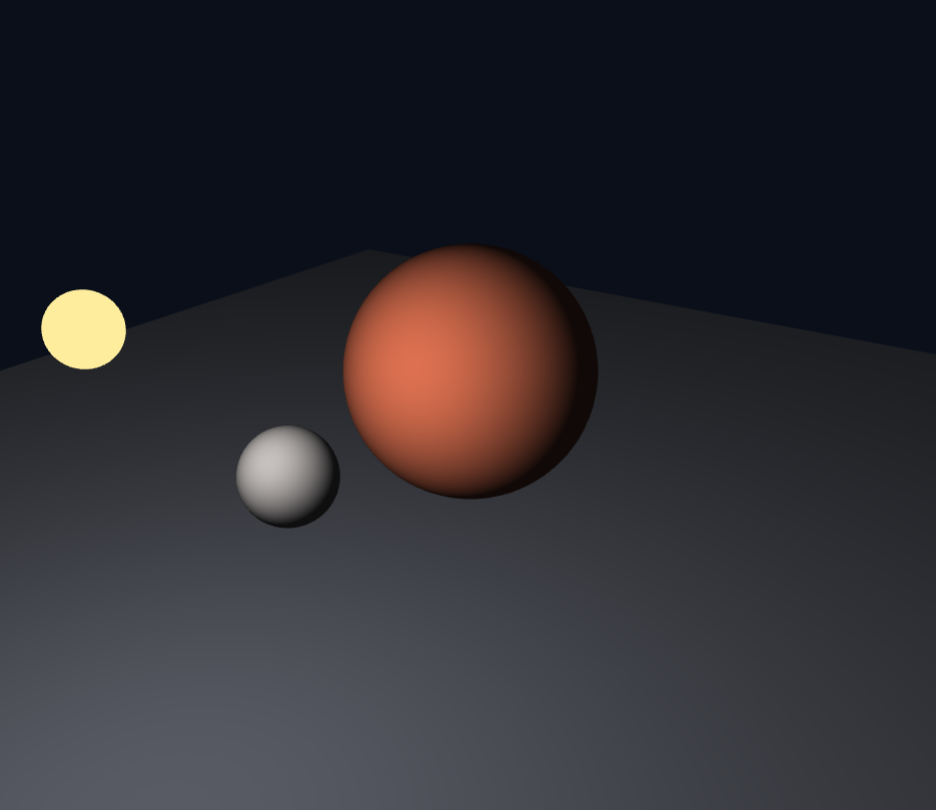
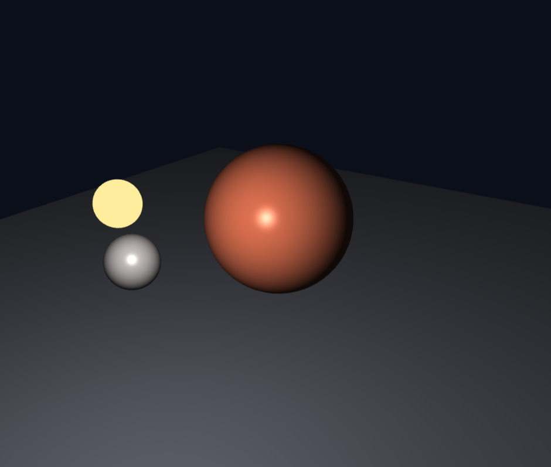
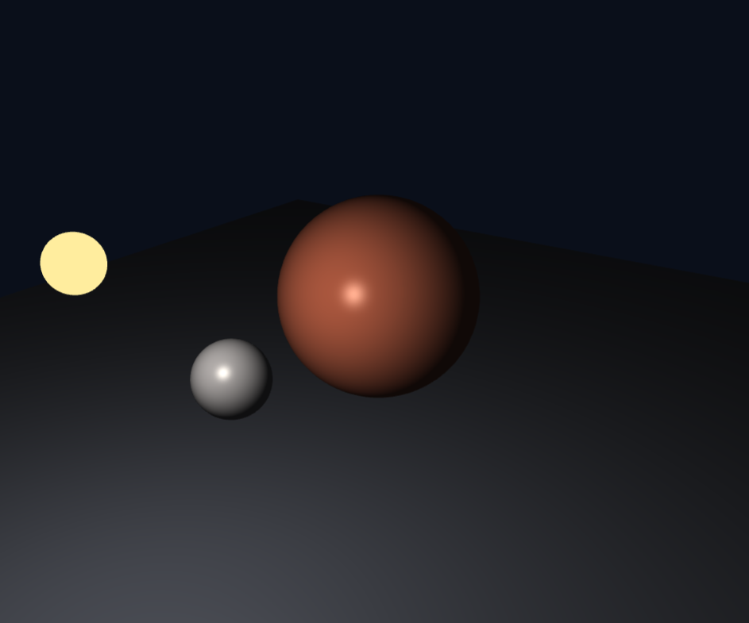
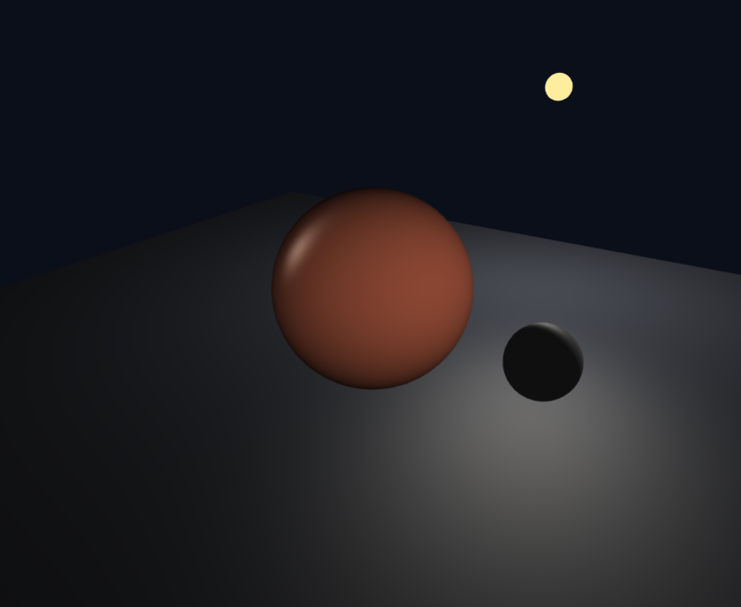
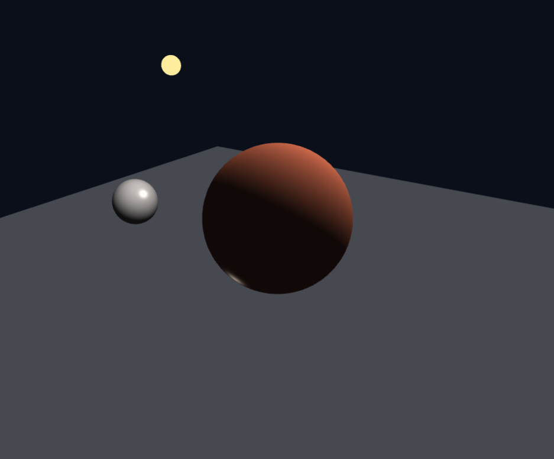
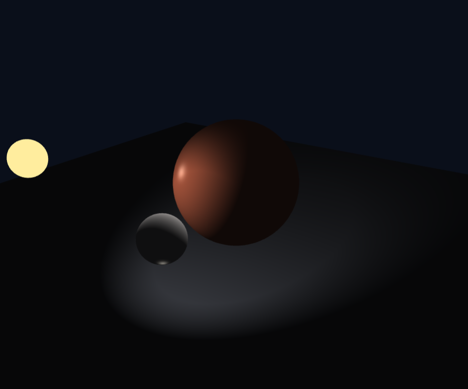

# 5주차 - 빛과 색

- 이름: 장예령
-저장소: https://github.com/yeryoung-jang/cg-2026-solar
-실행: [Task 1](https://yeryoung-jang.github.io/cg-2026-solar/week5/task1.html)

<br>

## Task 1 - 납작한 원을 구로 만들기

###  1. 시작 화면

처음에는 `uBaseColor`를 그대로 출력했기 때문에 표면의 방향과 관계없이 모든 픽셀이 같은 색으로 표시되었습니다.

```glsl
fragColor = vec4(uBaseColor, 1.0);
```

이 상태에서는 물체가 실제로 구 형태이더라도 표면의 명암 차이가 없어 입체적인 형태를 구분하기 어려웠습니다.



### 2. Diffuse - 확상관

표면의 법선 벡터 `N`과 광원을 향하는 벡터 `L`의 내적을 이용하여 확산광을 계산했습니다.

```glsl
vec3 diffuse = max(dot(N, L), 0.0) * uBaseColor * uLightColor;

fragColor = vec4(diffuse, 1.0);
```

적용 후에는 빛을 받는 부분이 밝아지고 반대쪽은 검게 표현되면서 구의 입체감이 나타났습니다. 광원이 이동하면 밝은 부분도 함께 변하는 것을 확인했습니다.



**max 제거 실험**

`max()`를 제거하면 빛을 받지 않는 면에서 `dot(N, L)`이 음수가 될 수 있으므로 음수 밝기가 계산될 것으로 예상했다.

```glsl
vec3 diffuse = dot(N, L) * uBaseColor * uLightColor;
```

실제로 코드를 수정해 보았지만 화면에서는 눈에 띄는 차이를 확인하기 어려웠습니다. 최종 색상 출력에서 음수 값이 0으로 제한되기 때문입니다. 

따라서 화면에서는 차이가 거의 없더라도 확산광 계산에서 음수값이 사용되지 않도록 `max()`를 유지하는 것이 적절하다고 판단했습니다.

### 3. Ambient - 환경광

확산광만 적용했을 때는 빛을 받지 않는 면이 완전히 검게 나타났다. 이를 보완하기 위해 물체의 기본 색상에 일정한 환경광을 더했습니다.

```glsl
vec3 ambient = 0.08 * uBaseColor;

fragColor = vec4(ambient + diffuse, 1.0);
```

처음에는 `fragColor`에 `ambient`만 넣어서 실행했는데, 광원이 움직여도 행성이 계속 어둡게 보였습니다.

코드를 확인한 결과 `diffuse`를 계산했지만 최종 색상에 더하지 않은 것이 원인이었습니다. 이후 `ambient + diffuse`로 수정하자 광원의 이동에 따라 밝은 부분이 달라지는 모습을 다시 확인할 수 있었습니다.



1단계와 비교했을 때 큰 차이는 없었지만 검게 보이던 부분에도 아주 어둡게 원래 색상이 남는 것을 확인했습니다. 환경관의 세기가 `0.08`로 작기 때문에 차이가 크게 나타나지는 않았습니다.

### 4. Specular — 정반사

빛이 표면에서 반사되는 방향 `R`과 카메라를 향하는 방향 `V`를 이용하여 정반사를 계산했습니다.

```glsl
vec3 R = reflect(-L, N);
vec3 specular = pow(max(dot(R, V), 0.0), uShininess) * uLightColor * 0.5;

fragColor = vec4(ambient + diffuse + specular, 1.0);
```

처음에는 2단계와 차이가 크지 않아 정반사가 제대로 적용되었는지 확인하기 어려웠습니다.

그래서 다른 조명 성분을 제외하고 정반사만 출력해 보았습니다.

```glsl
fragColor = vec4(specular, 1.0);
```

그 결과 대부분의 표면은 검게 보이고 빛이 반사되는 일부 영역에서만 하얀 하이라이트가 나타났습니다.

정반사가 정상적으로 계산되고 있음을 확인한 후 최종 출력 코드로 다시 복구했습니다.



확산광은 표면의 전체적인 명암을 만들지만 정반사는 특정 위치에 하이라이트를 추가한다는 차이를 확인했습니다.

### 5. Attenuation — 거리 감쇠

광원과 물체 표면 사이의 거리에 따라 빛의 세기가 달라지도록 거리 감쇠를 추가했습니다.

```glsl
float d = length(uLightPos - vWorldPos);
float att = 1.0 / (1.0 + 0.02 * d * d);

fragColor = vec4(ambient + (diffuse + specular) * att, 1.0);
```

여기서 `d`는 광원과 표면 사이의 거리이고 `att`는 거리가 멀어질수록 작아지는 감쇠값입니다.

환경광은 특정 광원의 위치와 관계없이 적용되므로 `ambient`에는 거리 감쇠를 곱하지 않았습니다.



적용 후에는 광원과 가까운 영역이 상대적으로 밝고 멀리 떨어진 영역은 어둡게 표현되었습니다. 이전 단계보다 전체적인 밝기가 약해졌으며 바닥에서도 광원과의 거리에 따른 밝기 차이를 확인할 수 있었습니다.

### 6. 법선 행렬 적용

기존 버텍스 셰이더에서는 모델 행렬의 3×3 부분을 사용하여 법선을 변환했습니다.

```glsl
vNormal = mat3(uModel) * aNormal;
```

이를 법선 행렬 `uNormalMat`를 사용하는 방식으로 변경했습니다.

```glsl
vNormal = uNormalMat * aNormal;
```

현재 장면에서는 행성과 달의 각 축에 동일한 비율로 스케일을 적용하고 있어 변경 전후의 차이가 거의 나타나지 않았다.

법선 행렬은 특히 축마다 확대 비율이 다른 비균일 스케일에서 필요하다. 이 경우 모델 행렬을 그대로 사용하면 변환된 법선이 표면에 수직인 방향과 달라질 수 있기 때문이다.




### 7. 광원 종류 비교

기존 Point Light를 Directional Light와 Spot Light로 변경하여 세 광원의 차이를 확인했습니다.

#### Point Light

기존 코드에서는 각 표면에서 광원의 위치를 향하는 방향을 계산하고 거리 감쇠를 적용했습니다.

```glsl
vec3 L = normalize(uLightPos - vWorldPos);
```

광원과 가까운 부분이 상대적으로 밝게 표현되며, 광원이 이동할 때 행성과 바닥의 명암도 함께 변했습니다.


#### Directional Light

광원의 위치 대신 일정한 방향 벡터를 사용하고 거리 감쇠를 제거했습니다.

```glsl
vec3 L = normalize(vec3(0.4, 0.8, 0.5));
float att = 1.0;
```

Point Light와 달리 바닥 전체가 비교적 균일한 밝기로 표현되었습니다. 광원 표시용 구가 움직여도 실제 조명 방향은 변하지 않았습니다.



#### Spot Light

Point Light의 위치 기반 방향 계산을 복구한 뒤, 특정 방향의 원뿔 범위 안에서만 빛이 적용되도록 구현했습니다.

```glsl
vec3 spotDir = normalize(vec3(0.0, 0.0, 0.0) - uLightPos);

float c = dot(-L, spotDir);
float cosInner = cos(radians(16.0));
float cosOuter = cos(radians(28.0));

att *= clamp((c - cosOuter) / (cosInner - cosOuter), 0.0, 1.0);
```

처음에는 광원이 수직 아래를 향하도록 설정했지만 현재 카메라 화면에서는 빛이 비치는 영역을 확인하기 어려웠습니다.

이후 광원이 장면의 중심을 향하도록 수정했습니다. 또한 앞서 Directional Light를 구현할 때 사용한 고정 방향 벡터가 남아 있어, `L`을 다시 광원의 위치를 기준으로 계산하도록 변경했습니다.

수정 후에는 바닥의 특정 영역만 밝아지고 주변은 어두운 모습이 나타났습니다.



세 광원을 비교한 결과 Point Light는 광원과의 거리에 따라 밝기가 감소했고, Directional Light는 넓은 영역에 일정한 방향의 빛을 적용했습니다. 반면 Spot Light는 원뿔 범위 안에만 빛을 집중시켜 바닥에 제한된 조명 영역을 만들었습니다.

같은 장면이더라도 광원 종류에 따라 빛이 분포하는 방식이 다르게 나타나는 것을 확인했습니다. 

<br>

## Task 1 구현 과정에서 확인한 문제

이번 실습에서는 코드를 추가한 후 화면이 예상과 다르게 보이는 경우가 여러 번 있었습니다.

처음 Diffuse를 적용할 때는 조명 계산 코드를 자체 발광을 처리하는 `if (uEmissive)` 내부에 작성하여 화면이 정상적으로 출력되지 않았습니다. 해당 부분을 원래대로 복구하고 법선 벡터와 광원 방향 벡터가 선언된 이후에 조명 계산을 추가하여 해결했습니다.

Ambient 단계에서는 확산광을 최종 출력에 포함하지 않아 광원의 움직임과 관계없이 행성이 계속 어둡게 보였습니다. `ambient + diffuse`로 수정하면서 조명 성분을 계산하는 것뿐만 아니라 최종 색상에 올바르게 합산하는 것도 중요하다는 점을 알게 되었습니다.

Specular 단계에서는 결과 차이가 작아 정반사만 따로 출력해 하이라이트를 확인했고, Spot Light 단계에서는 광원 방향과 표면에서 광원을 향하는 방향을 함께 수정하여 원하는 조명 영역을 만들었습니다.

<br>

## AI 활용 사례

이번 실습에서는 ChatGPT를 이용하여 교수님이 제공한 시작 코드의 구조를 확인하고 각 조명 계산의 역할과 수정 위치를 이해했습니다.

Diffuse, Ambient, Specular, 거리 감쇠를 단계별로 추가하는 방법을 질문했고 실행 화면을 직접 확인하면서 예상 결과와 비교했습니다.

특히 Ambient 단계에서 화면이 계속 어두운 원인을 질문했고 작성한 코드를 공유하여 최종 출력에 `diffuse`가 빠져 있다는 점을 확인했습니다.

또한 Specular의 효과가 잘 보이지 않아 정반사만 따로 출력하는 방법을 사용했고 Spot Light에서는 빛의 방향을 조정하면서 바닥에 조명 영역이 나타나도록 수정했습니다.

각 단계에서 코드를 직접 수정하고 실행 결과를 확인하면서 문제가 발생한 부분을 다시 수정하는 방식으로 진행했습니다.

<br>


## Task 1 최종 정리

이번 실습에서는 조명이 없는 장면에서 시작하여 Phong 반사 모델의 각 성분을 순서대로 적용했습니다.

Diffuse를 통해 구의 밝은 면과 어두운 면을 구분하고 Ambient로 빛이 직접 닿지 않는 면에도 약한 밝기를 추가했습니다. Specular를 통해 반사광에 의한 하이라이트를 표현했으며 거리 감쇠로 광원과 물체 사이의 거리도 밝기에 반영했습니다.

또한 Point, Directional, Spot Light를 비교하면서 광원 종류에 따라 바닥과 물체에 빛이 퍼지는 방식이 달라지는 것을 확인했습니다.

이번 실습을 통해 같은 형태와 기본 색상의 물체라도 조명의 방향, 세기, 종류에 따라 입체감과 표면의 느낌이 달라질 수 있다는 점을 확인했습니다.

<br>

## Task 2 - 빛으로 분위기 만들기


