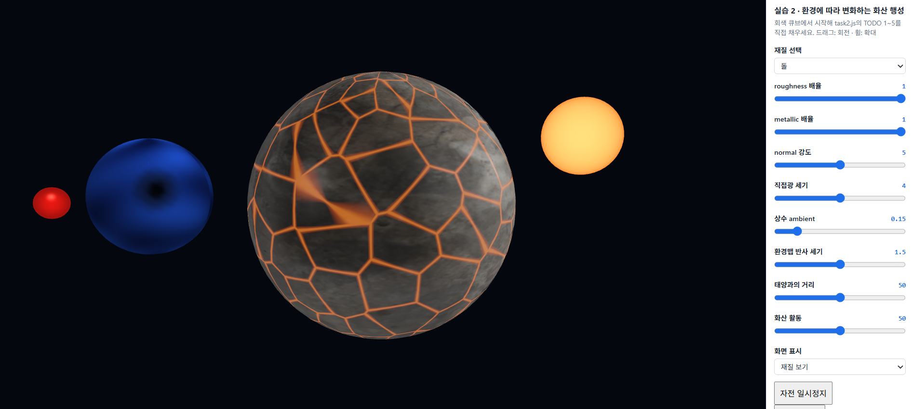
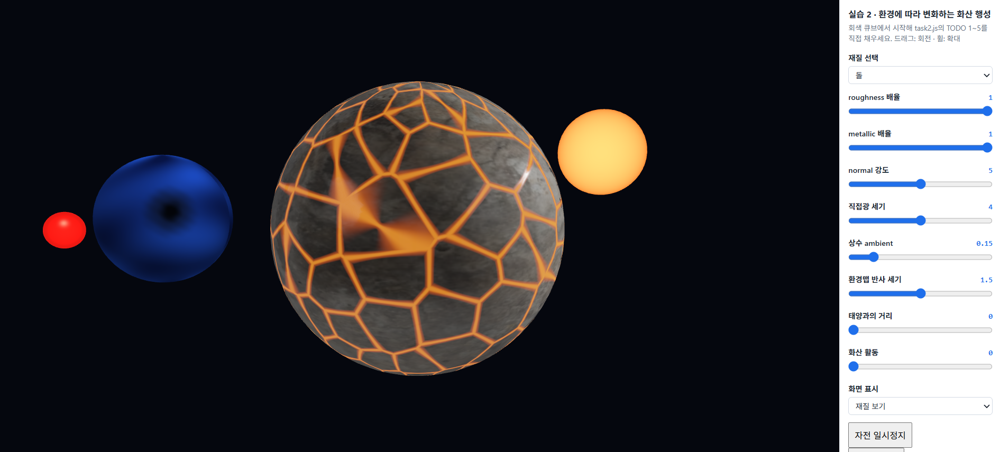
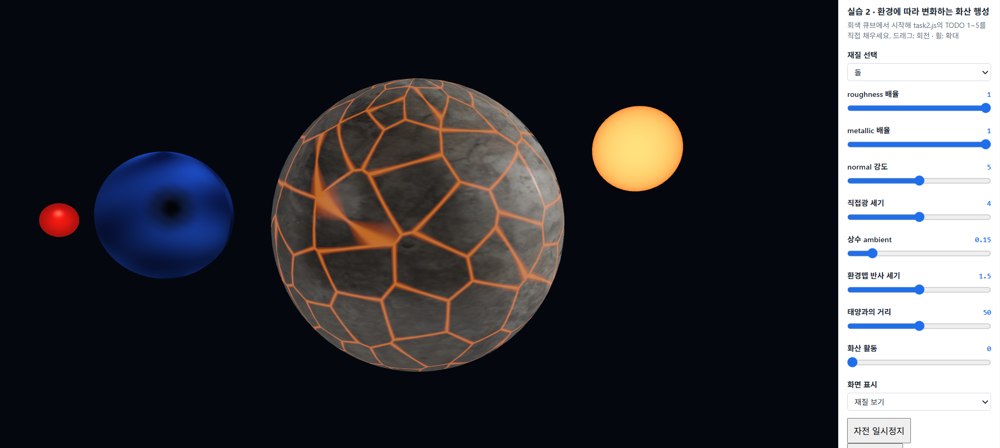
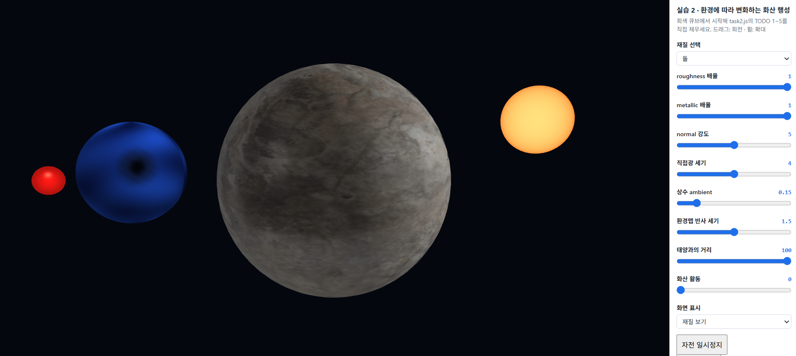
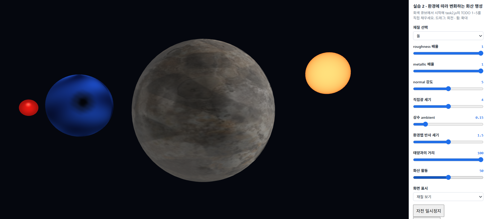
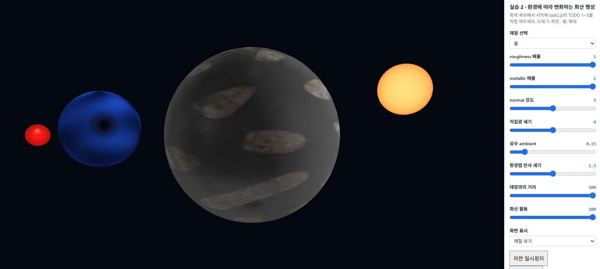
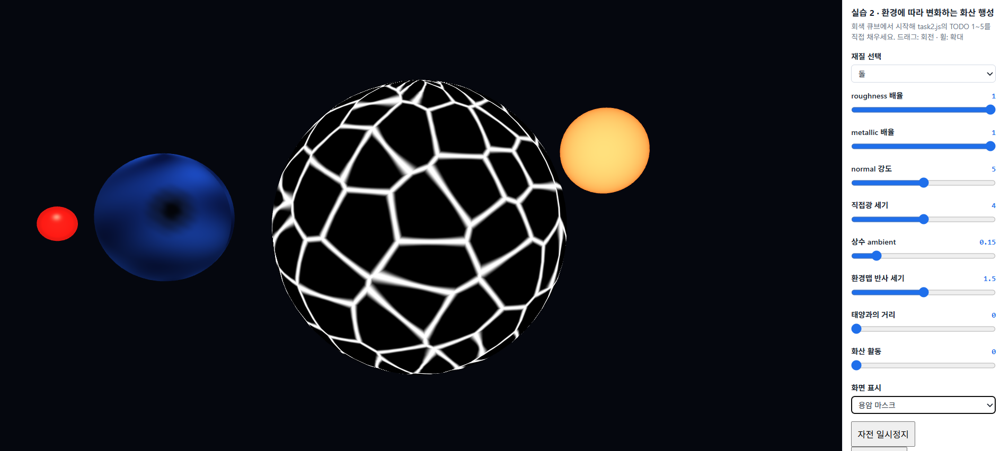
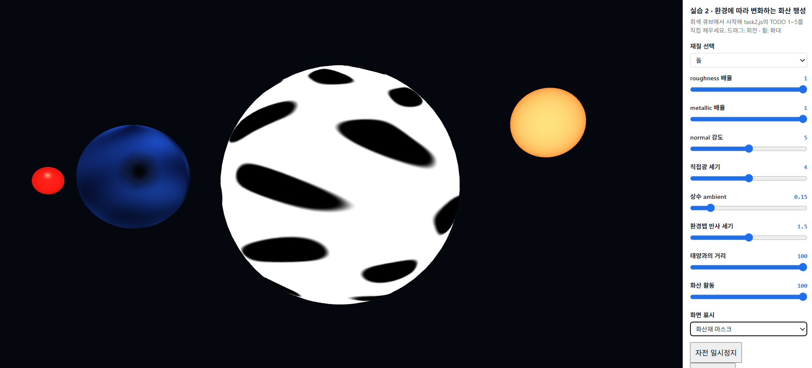
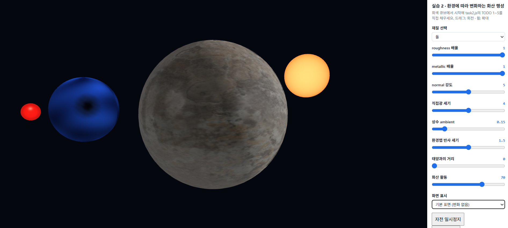
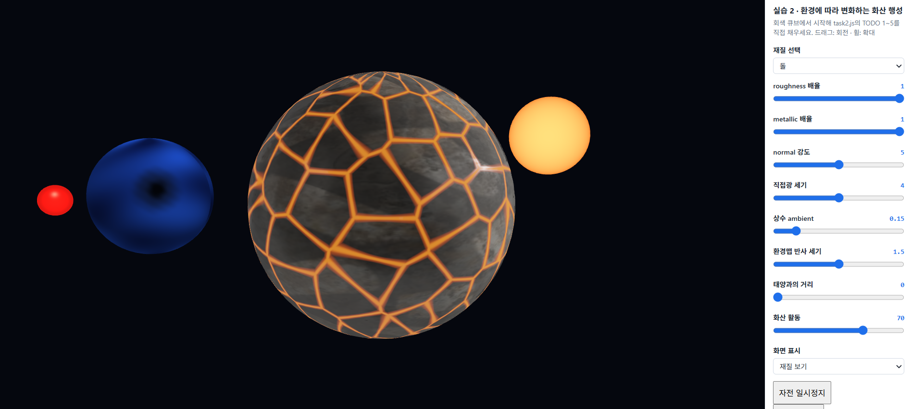

# 6주차 - PBR과 텍스처 매핑

- 이름: 장예령
- 저장소: https://github.com/yeryoung-jang/cg-2026-solar
- 실행: [Task 1](https://yeryoung-jang.github.io/cg-2026-solar/week6/task1.html) · [Task 2](https://yeryoung-jang.github.io/cg-2026-solar/week6/task2.html)

<br>

## Task 1 - 같은 물건이 다른 재료로 보이게 만들기

교수님이 제공한 시작 코드에서 TODO 1-5를 구현하여 같은 큐브에 나무, 금속, 돌의 재질을 적용했습니다.

Color Map으로 표면 색상을 표현하고 PBR 조명과 ARM Map, Normal Map, Enviroment Map을 순서대로 추가했습니다.

### 1. Color Map 적용

처음의 텍스처가 없는 회색 큐브 상태에서 UV 좌표를 이용해 색상 텍스처를 읽고 sRGB 색상을 선형 색 공간으로 변환하여 조명 계산에 사용했습니다.

```glsl
vec3 base=srgbToLinear(texture(uColor,vUV).rgb)*uTint;
```
적용 후에는 큐브 표면에 갈색 녹과 회색 금속 무늬가 나타났습니다. 큐브의 형태를 변경하지 않고 텍스처만으로 표면의 색상을 표현할 수 있었습니다.


### 2. PBR 조명 구현

기존 Phong 조명을 PBR 조명으로 변경하기 위해 `directPBR()` 함수를 구현했습니다.

PBR에서는 표면의 거칠기와 금속성 등을 고려하여 빛의 반사를 계산합니다.

- D (GGX): 표면의 거칠기에 따른 반사광의 분포
- F (Fresnel): 보는 각도에 따른 반사율
- G (Smith-Schlick): 표면의 미세한 굴곡으로 인해 빛이 가려지는 정도

```glsl
float D=a2/max(PI*d*d,1e-7);
vec3 F0=mix(vec3(0.04),base,metal);
vec3 F=F0+(1.0-F0)*pow(1.0-max(dot(H,V),0.0),5.0);

float k=(r+1.0)*(r+1.0)/8.0;
float G=(nv/(nv*(1.0-k)+k))*(nl/(nl*(1.0-k)+k));
```

계산한 D, F, G를 이용해 정반사와 확산 반사를 합산했습니다.

```glsl
vec3 specular=D*F*G/max(4.0*nv*nl,1e-6);
vec3 kd=(1.0-F)*(1.0-metal);

return (kd*base/PI+specular)*nl;
```

PBR 조명을 처음 적용했을 때는 기존보다 큐브가 전체적으로 어둡게 나타났습니다. 특히 금속 재질은 확산 반사 성분이 작고 환경맵도 아직 적용되지 않았기 때문에 표면이 어둡게 보였습니다. 이후 ARM Map과 환경 반사를 추가하면서 재질의 차이를 더 명확하게 확인할 수 있었습니다.

### 3. ARM Map 적용

ARM Map은 하나의 텍스처에 AO, Roughness, Metallic 정보를 RGB 채널로 저장한 맵입니다.

```glsl
vec3 arm=texture(uARM,vUV).rgb;
ao=arm.r;
rough=max(arm.g*uRough,0.045);
metal=arm.b*uMetal;
```

각 채널의 역할은 다음과 같습니다.

- R (AO): 간접광이 닿기 어려운 부분의 밝기 조절
- G (Roughness): 표면의 거칠기 조절
- B (Metallic): 금속성 조절


ARM Map을 적용하면 표면 전체에 동일한 재질 값을 사용하는 대신 위치마다 서로 다른 roughness와 metallic 값을 적용할 수 있습니다.

녹슨 금속에서는 갈색 녹이 발생한 부분과 회색 금속이 노출된 부분의 재질 특성이 다르게 표현됩니다.

**Metallic 배율 비교**

Metallic 배율을 1에서 0으로 낮추어 변화를 확인했습니다.


Metallic 배율을 0으로 변경하자 기존보다 큐브가 밝아지는 것을 확인했습니다.

금속 재질은 주로 정반사를 통해 빛을 표현하지만, metallic을 0으로 낮추면 비금속의 확산 반사 성분이 증가하기 때문입니다.

이를 통해 같은 색상 텍스처를 사용하더라도 metallic 값에 따라 표면의 밝기와 반사 특성이 달라진다는 것을 확인했습니다.

### 4. Normal Map 적용

Normal Map을 이용하여 실제 큐브의 형태를 변경하지 않고 표면의 작은 흠집과 굴곡을 표현했습니다.

텍스처에서 읽은 법선은 접선 공간을 기준으로 하기 때문에 TBN 행렬을 이용하여 조명 계산에 사용하는 좌표계로 변환했습니다.

```glsl
vec3 mapN=texture(uNormal,vUV).xyz*2.0-1.0;
mapN.xy *= uNormalStrength;
N=normalize(mat3(T*inv,B*inv,N)*normalize(mapN));
```

**Normal 강도 비교**

Normal 강도를 0과 5로 변경하여 같은 시점에서 비교했습니다.


처음에는 두 설정의 차이가 크게 느껴지지 않았지만 큐브를 확대하여 관찰하자 표면의 작은 명암 차이가 나타났습니다.

Normal Map은 실제 정점의 위치를 변경하는 것이 아니라 조명 계산에 사용하는 법선 방향만 변경합니다. 따라서 표면의 굴곡이 표현되더라도 큐브의 외곽선은 그대로 유지되었습니다.

### 5. Environment Map 적용

주변 환경이 물체 표면에 반사되도록 Environment Map을 추가했습니다.

카메라 방향과 표면 법선을 이용해 반사 방향을 계산하고, 해당 방향의 환경 이미지 색상을 읽도록 구현했습니다.

```glsl
vec3 reflected = reflect(-V,N);
vec2 envUV = vec2(atan(reflected.z,reflected.x)/(2.0*PI)+0.5,
                  asin(clamp(reflected.y,-1.0,1.0))/PI+0.5);
vec3 envColor = srgbToLinear(textureLod(uEnv,envUV,rough*7.0).rgb);
vec3 envF0 = mix(vec3(0.04),base,metal);
color += uEnvPower * ao * envColor * envF0;
```

**환경맵 반사 세기 비교**

환경맵의 영향만 확인하기 위해 직접광과 ambient를 모두 0으로 설정했습니다.

**환경맵 반사 세기 0**


모든 조명 성분을 0으로 설정하자 큐브가 검게 나타났습니다.

**환경맵 반사 세기 2**


환경맵 반사 세기를 높이자 직접광이 없는 상태에서도 큐브의 표면이 보였습니다.

이는 주변 환경 이미지에서 맑은 반사광이 표면 색상에 더해지기 때문입니다.

이번 비교를 통해 직접광과 ambient를 끄더라도 Environment Map이 적용되어 있으면 금속 표면에 반사광이 나타날 수 있다는 것을 확인했습니다.

### 6. 재질별 비교

같은 큐브에 나무, 금속, 돌의 텍스처를 적용하여 표면의 차이를 비교했습니다.

**나무 재질**


**돌 재질**


나무와 돌은 금속과 달리 metallic 값이 거의 0인 비금속 재질입니다.

나무는 목재 특유의 색상과 무늬가 나타났고, 돌은 암석 표면의 색상과 거친 질감이 표현되었습니다.

같은 메시를 사용하더라도 Color Map, Roughness, Metallic, Normal Map의 값에 따라 서로 다른 재질로 보인다는 것을 확인했습니다.

### 7. 텍스처 필터링 비교

교수님이 제공한 텍스처 필터링 예제에서 NEAREST와 LINEAR_MIPMAP_LINEAR의 차이를 비교했습니다.

**NEAREST 필터**


NEAREST는 가장 가까운 텍셀 하나의 값을 사용합니다. 따라서 텍스처가 축소될 때 무늬가 깨지거나 계단 현상이 나타나기 쉽습니다.

**LINEAR_MIPMAP_LINEAR 필터**


LINEAR_MIPMAP_LINEAR는 거리에 맞는 밉맵 단계와 주변 텍셀을 보간하여 색상을 계산합니다.

이 방식은 멀리 있는 텍스처의 무늬를 더 부드럽고 안정적으로 표현할 수 있습니다.

두 설정을 비교하면서 텍스처가 화면에서 작게 표시될 때는 밉맵을 이용한 필터링이 필요하다는 것을 알 수 있었습니다.

<br>

## Task 1 구현 과정에서 확인한 문제

이번 실습에서는 TODO를 순서대로 구현하면서 몇 가지 문제를 확인했습니다.

TODO 2에서 PBR 조명을 구현한 직후 큐브가 기존보다 어둡게 나타났습니다. 처음에는 조명 계산에 문제가 있는지 확인했지만, 금속 재질의 확산 반사 성분이 작고 아직 Environment Map이 적용되지 않은 상태라는 점을 확인했습니다.

TODO 3에서는 ARM Map 코드를 추가하는 과정에서 `rough`, `metal`, `ao` 변수 선언이 누락되어 셰이더 컴파일 오류가 발생했습니다.

기존 변수 선언을 다시 추가하여 문제를 해결했습니다.

```glsl
float rough=uRough,metal=uMetal,ao=1.0;
```

TODO 4에서는 Normal 강도를 변경해도 표면 차이가 크게 보이지 않았습니다. 이후 큐브를 확대하고 Normal 강도를 높여 관찰하면서 미세한 명암 변화를 확인했습니다.

또한 Color Map, ARM Map, Normal Map은 각각 다른 정보를 저장하므로 색상 텍스처에만 sRGB 변환을 적용하고, 수치 데이터인 ARM과 Normal Map에는 적용하지 않도록 구분했습니다.

<br>

## Task 1 AI 활용 사례

이번 실습에서는 ChatGPT를 활용하여 `task1.js`의 TODO 1~5 구현 방법을 확인하고 코드를 단계별로 수정했습니다.

기존 파일 구조를 유지하면서 각 TODO에 필요한 코드만 추가했으며, 수정할 때마다 브라우저에서 실행 결과를 확인했습니다.

특히 PBR 조명에서는 GGX, Fresnel, Smith-Schlick의 계산식을 함수에 적용하는 방법을 확인했습니다.

ARM Map을 적용한 뒤 변수 선언이 누락되어 발생한 셰이더 오류를 해결했고, Normal Map의 효과가 잘 보이지 않았을 때는 슬라이더 설정을 변경하여 실제 적용 여부를 확인했습니다.

또한 완성된 코드와 별도로 TODO 1만 구현한 파일을 임시로 만들어 단계별 비교 화면을 캡처했습니다. 캡처가 끝난 후에는 임시 파일을 삭제하고 최종 코드를 유지했습니다.

AI가 제안한 코드를 그대로 적용하는 것에서 끝내지 않고, 실행 화면과 슬라이더의 변화를 비교하면서 각 기능이 정상적으로 작동하는지 확인했습니다.

<br>

## Task 1 최종 정리 

이번 실습에서는 회색 큐브에 Color Map, PBR 조명, ARM Map, Normal Map, Environment Map을 순서대로 적용했습니다.

Color Map으로 표면의 색상을 표현하고, ARM Map을 이용해 위치마다 다른 거칠기와 금속성을 적용했습니다. Normal Map은 실제 형태를 변경하지 않고 표면의 미세한 굴곡을 표현하는 데 사용했습니다.

또한 Environment Map을 통해 직접광이 없는 상태에서도 주변 환경에 의한 반사광이 나타나는 것을 확인했습니다.

나무, 금속, 돌의 재질을 비교하면서 같은 형태의 물체라도 텍스처와 PBR 재질 값에 따라 서로 다르게 보일 수 있다는 것을 알게 되었습니다.

<br>

## Task 1 텍스처 출처 및 라이선스

교수님이 제공한 시작 코드의 Poly Haven 텍스처(Wood Planks, Rusty Metal 04, Rock Boulder Dry, Studio Small 09)를 사용했습니다.

모두 CC0 라이선스이며, 파일별 출처는 `assets/week06/sources.json`을 참고했습니다.

<br>

## Task 2 - 나만의 태양계에 새 행성 만들기

5주차에 제작한 파란 행성과 붉은 경고 비콘의 콘셉트를 활용하여 태양계 장면을 확장하고 새로운 행성을 추가했습니다.

파란 행성에는 task 1에서 구현한 PBR 조명과 텍스처, Normal Map을 적용했습니다. 또한 태양과의 거리 및 화산 활동에 따라 표면 재질이 달라지도록 두 가지 변화 규칙을 구현했습니다.

### 1. 행성 설정 및 실습 목표

새로운 행성은 암석으로 이루어진 화산 행성으로 설정했습니다. 태양에 가까워질수록 표면의 균열 사이로 용암이 드러나고 화산 활동이 활발해질수록 검은 화산재가 넓게 쌓이도록 구현했습니다.

| 구분 | 첫 번째 조건 | 두 번째 조건 |
|---|---|---|
| 변화 원인 | 태양과의 거리 | 화산 활동 |
| 조절 범위 | 0~100 | 0~100 |
| 영향받는 영역 | 암석 표면의 균열 | 불규칙한 화산재 분포 영역 |
| 색상 변화 | 주황색 용암 생성 | 검은색 화산재 생성 |
| Roughness 변화 | 용암 영역은 감소 | 화산재 영역은 증가 |
| 마스크 | 용암 마스크 | 화산재 마스크 |

두 조건은 각각 독립적인 슬라이더로 조절할 수 있으며, 값에 따라 표면의 변화 범위가 연속적으로 달라지도록 했습니다.

### 2. 태양계 장면 구현

기존 task 1의 큐브를 UV 좌표가 있는 구형 메시로 변경하고, 5주차에 구현했던 파란 행성과 붉은 경고 비콘을 참고하여 태양계 장면을 구성했습니다.

```javascript
const mesh=D.upload(gl,D.revolution(D.profiles.sphere(0.95,32),64));
```

`D.profiles.sphere()`로 구의 단면을 생성하고, `D.revolution()`을 이용하여 UV 좌표가 포함된 구형 메시를 만들었습니다.

또한 모델 행렬을 사용하여 행성이 자전하도록 구현했습니다.

```glsl
vec4 worldPos=uModel*vec4(aPos,1.0);
vP=worldPos.xyz;
vN=mat3(uModel)*aNormal;
vLocal=aPos;
vUV=aUV;
gl_Position=uVP*worldPos;
```

모델 행렬을 이용해 정점의 위치와 법선 방향을 함께 회전시켜 조명 계산에 반영했습니다. 현재 모델에는 회전과 이동만 사용하므로 `mat3(uModel)`로 법선을 변환했습니다.

장면에는 다음과 같은 천체를 배치했습니다.

- 파란 행성: 5주차의 격리 행성 콘셉트를 참고하여 표면 이상 영역을 표현
- 붉은 경고 비콘: 파란 행성 주변을 공전하며 붉은빛의 밝기가 주기적으로 변화
- 화산 행성: PBR 재질과 두 가지 환경 변화 규칙을 적용한 새로운 행성
- 태양: 노란색과 주황색으로 표현한 발광 천체

5주차의 파란 행성과 경고 비콘은 기존 코드를 그대로 옮기기보다 6주차 렌더링 구조에 맞게 일부 단순화하여 다시 구현했습니다.

화산 행성은 자동으로 자전하며 비교 화면을 확인할 수 있도록 자전 일시정지 및 다시 시작 버튼도 추가했습니다.



### 3. 태양과의 거리에 따른 용암 생성

첫 번째 조건은 태양과의 거리입니다.

슬라이더 값이 0이면 태양이 가까운 상태, 100이면 멀리 있는 상태로 설정했습니다. 거리 값에 따라 화면에 표시된 태양의 위치와 화산 행성의 용암 영역이 함께 변하도록 구현했습니다.

```javascript
const sunDistance=1.3+S.distance*0.005;
```

또한 태양의 위치를 광원 방향 계산에 연결하여, 태양이 이동하면 화산 행성의 직접광 방향도 달라지도록 했습니다.

용암 영역을 계산하기 위해 거리 값을 0~1 범위의 `heat` 값으로 변환했습니다.

```glsl
float heat=1.0-clamp(uDistance/100.0,0.0,1.0);
```

태양과의 거리가 가까울수록 `heat`가 증가하고, 멀어질수록 감소합니다.

암석 표면의 균열은 UV 좌표와 불규칙한 영역 경계를 이용하여 계산했습니다. 처음에는 `sin()` 함수로 반복적인 곡선을 생성했지만, 이후 Voronoi 방식의 균열 패턴으로 변경했습니다.

```glsl
float cracks=crackPatternWrapped(vUV);

float lavaCore=heat*(1.0-smoothstep(0.012,0.024+0.06*heat,cracks));
float lavaGlow=heat*(1.0-smoothstep(0.020,0.060+0.10*heat,cracks));
float lavaMask=lavaGlow;
```

`lavaCore`는 균열의 중심 영역을, `lavaGlow`는 중심 주변까지 포함한 영역을 나타냅니다.

두 값을 구분하여 균열 중심과 가장자리의 색상 및 발광 세기를 다르게 표현했습니다.

```glsl
vec3 lavaEdgeColor=vec3(0.66,0.105,0.012);
vec3 lavaCoreColor=vec3(1.25,0.23,0.018);
vec3 lavaColor=mix(lavaEdgeColor,lavaCoreColor,lavaCore);

base=mix(base,lavaColor,lavaGlow);
rough=mix(rough,0.18,lavaGlow);
metal=mix(metal,0.0,lavaGlow);
```

기존 암석 표면에 용암 색상을 혼합하고, 용암 영역의 roughness를 낮추어 암석과 다른 반사 특성을 갖도록 했습니다.

또한 용암이 뜨겁게 빛나는 모습을 표현하기 위해 발광 성분을 추가했습니다.

```glsl
vec3 lavaEmission=
    vec3(2.05,0.30,0.018)*lavaCore
  + vec3(0.75,0.09,0.005)*max(lavaGlow-lavaCore,0.0);

color+=lavaEmission;
```

이 발광 효과는 용암 자체가 밝게 보이도록 색상을 더하는 방식이며, 주변 표면을 실제로 비추는 별도의 광원은 아닙니다.

### 4. 화산 활동에 따른 화산재 생성

두 번째 조건은 화산 활동입니다.

화산 활동 슬라이더가 0일 때는 화산재가 생성되지 않고, 100에 가까워질수록 표면에 검은 화산재가 넓게 퍼지도록 구현했습니다.

먼저 슬라이더 값을 0~1 범위로 변환했습니다.

```glsl
float ashActivity=clamp(uAsh/100.0,0.0,1.0);
```

이후 UV 좌표와 `sin()` 함수를 이용하여 화산재가 쌓일 위치를 계산했습니다.

```glsl
float ashPattern=0.5
  +0.25*sin(vUV.x*31.0+2.0*sin(vUV.y*17.0))
  +0.25*sin(vUV.y*41.0+2.0*sin(vUV.x*13.0));

float ashMask=ashActivity*
  (1.0-smoothstep(0.20+0.45*ashActivity,
                  0.30+0.45*ashActivity,ashPattern));
```

`ashPattern`은 표면 위치마다 다른 값을 생성하고, `ashMask`는 화산 활동의 세기에 따라 해당 영역에 화산재가 얼마나 쌓이는지 결정합니다.

화산재가 용암의 중심 영역을 덮지 않도록 다음 계산도 추가했습니다.

```glsl
ashMask*=1.0-lavaCore;
```

최종적으로 화산재가 생성된 영역에는 어두운 색상과 높은 roughness를 적용했습니다.

```glsl
base=mix(base,vec3(0.045,0.043,0.041),ashMask);
rough=mix(rough,0.92,ashMask);
metal=mix(metal,0.0,ashMask);
```

화산재의 roughness를 높게 설정하여 상대적으로 거칠고 반사가 약한 표면을 표현했습니다.

### 5. PBR 및 Normal Map 적용

화산 행성에는 실습 1에서 구현한 Color Map, ARM Map, Normal Map과 PBR 조명 계산을 재사용했습니다.

기본 표면에는 암석 텍스처를 적용하고, 위치별 마스크를 이용해 용암과 화산재 영역의 재질 값을 변경했습니다.

- Color Map: 암석 표면의 기본 색상 표현
- ARM Map: AO, roughness, metallic 정보 적용
- Normal Map: 실제 메시 형태를 변경하지 않고 표면의 미세한 굴곡 표현
- PBR 조명: GGX, Fresnel, Smith-Schlick 계산을 이용한 반사 표현

용암 영역은 roughness를 낮추고, 화산재 영역은 roughness를 높여 같은 행성 안에서도 위치에 따라 반사 특성이 달라지도록 했습니다. 또한 태양의 위치를 광원 방향과 연결하며, 태양과의 거리를 변경하면 표면의 명암 및 반사 위치도 달라지도록 구현했습니다.

### 6. 화면 비교 및 진단 기능

교수님이 요구하신 기본 표면과 변화한 표면의 비교, 두 마스크의 흑백 표시 기능을 구현했습니다.

`화면 표시` 메뉴에서 다음 네 가지 상태를 선택할 수 있습니다.

- 재질 보기: 용암과 화산재가 적용된 최종 표면
- 기본 표면 (변화 없음): 두 변화 효과를 제외한 암석 표면
- 용암 마스크: 용암이 생성되는 위치를 흑백으로 표시
- 화산재 마스크: 화산재가 쌓이는 위치를 흑백으로 표시

기본 표면을 선택하면 실제 슬라이더와 태양 위치는 유지하고, 셰이더에 전달되는 변화 조건만 기본 상태로 설정하도록 구현했습니다.

```javascript
gl.uniform1f(U.uDistance,S.viewMode==='base'?100:S.distance);
gl.uniform1f(U.uAsh,S.viewMode==='base'?0:S.ash);
```

이를 통해 카메라 위치와 슬라이더 설정을 유지한 상태에서 기본 표면과 변화한 표면을 비교할 수 있습니다.

<br>

### 7. 실행 결과 및 비교

#### 7-1. 태양과의 거리 비교

화산 활동을 0으로 고정하고 태양과의 거리만 0·50·100으로 변경하여 비교했습니다.

**태양과의 거리 0**



태양과의 거리가 가장 가까운 상태로, 암석 표면의 균열을 따라 용암이 넓게 나타났습니다.

특히 균열이 만나는 부분에서는 용암 영역이 더 넓게 표현되었습니다.

**태양과의 거리 50**



거리를 50으로 변경하자 용암 균열이 좁아지고 발광 영역도 감소했습니다.

기존 암석 표면이 더 많이 드러나는 것을 확인할 수 있었습니다.

**태양과의 거리 100**



태양과의 거리를 100으로 변경하면 `heat`가 0이 되면서 용암이 완전히 사라졌습니다.

이를 통해 거리 값에 따라 용암 영역의 크기와 발광 세기가 연속적으로 변화한다는 것을 확인했습니다.

#### 7-2. 화산 활동 비교

이번에는 태양과의 거리를 100으로 고정하여 용암의 영향을 제외하고, 화산 활동만 0·50·100으로 변경했습니다.

**화산 활동 0**

화산재가 없는 기본 암석 표면이 나타났습니다. 이 상태는 앞서 촬영한 `task2_distance_100.png`와 조건이 동일하므로 해당 화면을 공통 비교 자료로 사용했습니다.

**화산 활동 50**



화산 활동을 50으로 설정하자 암석 표면의 일부가 어두워졌습니다.

화산재가 부분적으로 쌓이면서 기존 암석의 색상과 거칠기가 변화했습니다.

**화산 활동 100**



화산 활동을 100으로 높이자 검은 화산재가 넓은 영역에 확산되었습니다.

일부 지역에서는 기존 암석이 드러나 있으며, 화산재가 덮인 부분과 덮이지 않은 부분의 차이를 확인할 수 있었습니다.

#### 7-3. 흑백 마스크 비교

두 변화 조건에서 계산한 마스크를 각각 흑백으로 표시하여 실제 적용 위치를 확인했습니다.

**용암 마스크**

설정: 태양과의 거리 0 / 화산 활동 0



용암이 생성되는 균열 부분은 흰색으로, 나머지 암석 영역은 검은색으로 나타났습니다.

균열 경계에는 회색 영역도 나타나는데, 이는 `smoothstep()`으로 마스크 값을 부드럽게 변화시켰기 때문입니다.

**화산재 마스크**

설정: 태양과의 거리 100 / 화산 활동 100



화산재가 강하게 쌓이는 영역은 흰색으로, 기존 암석이 드러나는 부분은 검은색으로 나타났습니다.

두 마스크의 분포 형태가 서로 다르며, 각각 독립적인 계산 규칙에 따라 생성된다는 것을 확인했습니다.

#### 7-4. 기본 표면과 변화한 표면 비교

태양과의 거리를 0, 화산 활동을 70으로 고정한 상태에서 화면 표시 메뉴만 변경하여 비교했습니다.

**기본 표면 (변화 없음)**



기본 표면에서는 용암과 화산재 효과가 적용되지 않아 원래의 암석 텍스처만 나타났습니다.

**변화한 표면**



같은 조건에서 재질 보기로 변경하자 용암 균열과 화산재에 의한 표면 변화가 함께 나타났습니다.

이를 통해 마스크가 행성 전체의 색상을 일괄적으로 변경하는 것이 아니라, 위치별로 색상과 재질 값을 다르게 적용한다는 것을 확인했습니다.

<br>

## Task 2 구현 과정에서 확인한 문제

이번 실습에서는 기존 태양계 장면을 확장하고 새로운 표면 변화 규칙을 구현하면서 여러 부분을 수정했습니다.

**1. 행성 및 태양계 장면 구성**

처음에는 실습 1의 큐브를 구형 메시로 변경하여 새로운 행성을 만들었습니다. 이후 5주차 태양계와 연결하기 위해 기존 파란 행성과 비콘의 콘셉트를 참고하여 장면에 추가했습니다.

초기에는 카메라 각도로 인해 파란 행성과 화산 행성이 겹쳐 보였습니다. 카메라의 기본 yaw 값을 수정하고 파란 행성의 위치를 조정하여 세 천체가 구분되도록 했습니다.

**2. 용암 균열의 형태 수정**

처음에는 `sin()` 함수를 이용해 균열을 만들었지만, 일정한 곡선이 반복되어 실제 암석의 균열처럼 보이지 않았습니다.

이를 개선하기 위해 불규칙한 영역 경계를 이용하는 Voronoi 방식으로 변경했습니다.

또한 UV 좌표의 경계에서 패턴이 끊겨 보이는 문제가 있어 수평 방향의 패턴이 이어지도록 좌표를 반복 처리하는 방식을 추가했습니다.

이후 용암 중심과 가장자리의 색상 및 발광 세기를 구분하여 단일한 주황색 선보다 자연스럽게 표현하도록 수정했습니다.

**3. 태양 및 파란 행성의 외형 수정**

태양은 처음에 단색의 노란 구로 구현했지만, 이후 중앙과 가장자리의 색상을 다르게 표현했습니다.

색상 변화를 추가하는 과정에서 반복적인 물결무늬가 나타나 해당 패턴 계산을 제거했습니다.

파란 행성은 우주 배경으로 변경한 뒤 표면이 너무 어둡게 보여 조명에 의한 밝기 계산을 조정했습니다.

**4. 비교 화면 구현**

행성이 계속 자전하는 상태에서는 표면 변화를 같은 위치에서 비교하기 어려워 자전 일시정지 기능을 추가했습니다.

또한 기본 표면과 변화한 표면을 선택할 수 있는 메뉴를 구형하여 슬라이더 값을 다시 조절하지 않고도 재질의 차이를 확인할 수 있도록 했습니다.

<br>

## Task 2 AI 활용 사례

이번 실습에서는 ChatGPT를 활용하여 5주차 태양계와 6주차 PBR 재질 구현 코드를 연결하는 방법을 확인했습니다.

먼저 실습 1의 큐브를 UV 구형 메시로 변경하고 모델 행렬을 이용해 자전하도록 구현했습니다.

이후 태양 거리와 화산 활동이라는 두 가지 조건을 정하고, 각 조건의 슬라이더 값을 표면 마스크 계산에 연결했습니다.

처음에는 규칙적인 용암 곡선을 생성했지만 실행 결과를 확인한 뒤 Voronoi 방식의 불규칙한 균열로 변경했습니다.

용암이 지나치게 밝고 단조롭게 보이는 부분도 직접 확인하여 중심과 가장자리의 색상, 발광 세기를 조정했습니다.

또한 UV 경계에서 균열이 끊겨 보이는 현상을 줄이기 위해 좌표 반복 처리 방식을 추가했습니다.

5주차의 파란 행성과 경고 비콘은 기존 코드를 참고하여 6주차 구조에 맞게 다시 구현했으며, 카메라와 천체 위치를 조정하여 전체 장면을 구성했습니다.

AI가 제안한 코드를 단계별로 적용하면서 브라우저에서 결과를 확인하고 의도한 표현과 다르게 나타나는 부분은 수정했습니다.

<br>

## Task 2 최종 정리

이번 실습에서는 5주차 태양계 장면에 새로운 화산 행성을 추가하고, 두 가지 환경 조건에 따라 표면 재질이 달라지도록 구현했습니다.

첫 번째 조건인 태양과의 거리는 용암 균열의 범위와 발광 세기에 영향을 주며, 두 번째 조건인 화산 활동은 검은 화산재가 쌓이는 영역을 변화시킵니다.

두 조건 모두 위치별 마스크를 코드로 계산하고, 이를 base color와 roughness, metallic에 연결했습니다.

또한 실습 1에서 구현한 PBR 조명과 Normal Map을 재사용하여 표면의 색상뿐 아니라 반사 특성과 명암도 표현했습니다.

기본 표면과 변화한 표면을 비교하는 기능, 두 마스크의 흑백 표시 기능을 추가하여 변화 규칙이 적용되는 위치를 확인할 수 있도록 했습니다.

이번 과제를 통해 완성된 텍스처를 단순히 교체하는 것과 달리, 코드에서 계산한 마스크를 이용하면 환경 조건에 따라 행성의 표면 재질을 동적으로 변화시킬 수 있다는 것을 알게 되었습니다.

<br>

## Task 2 텍스처 출처 및 라이선스

화산 행성의 기본 암석 표면에는 교수님이 제공한 시작 코드의 Poly Haven `Rock Boulder Dry` 텍스처를 사용했습니다.

CC0 라이선스 자료이며, 상세 출처 및 채널 정보는 실습 1의 텍스처 출처 항목과 `assets/week06/sources.json`을 참고했습니다.

용암과 화산재의 위치별 마스크는 외부 이미지를 사용하지 않고 GLSL 코드에서 직접 계산했습니다.