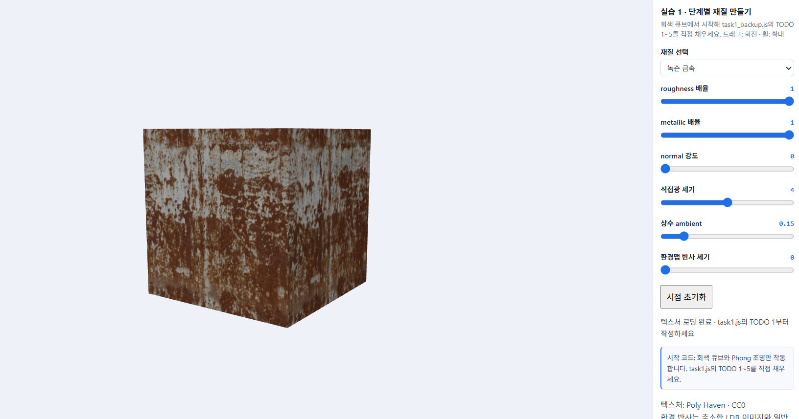
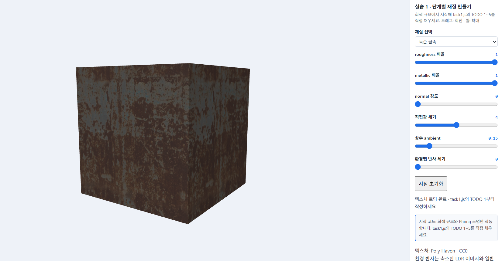
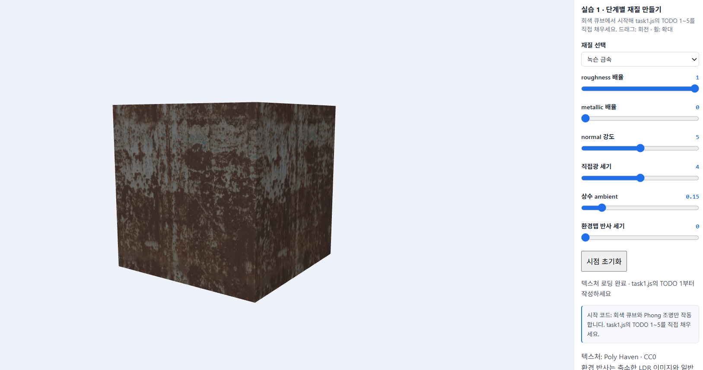
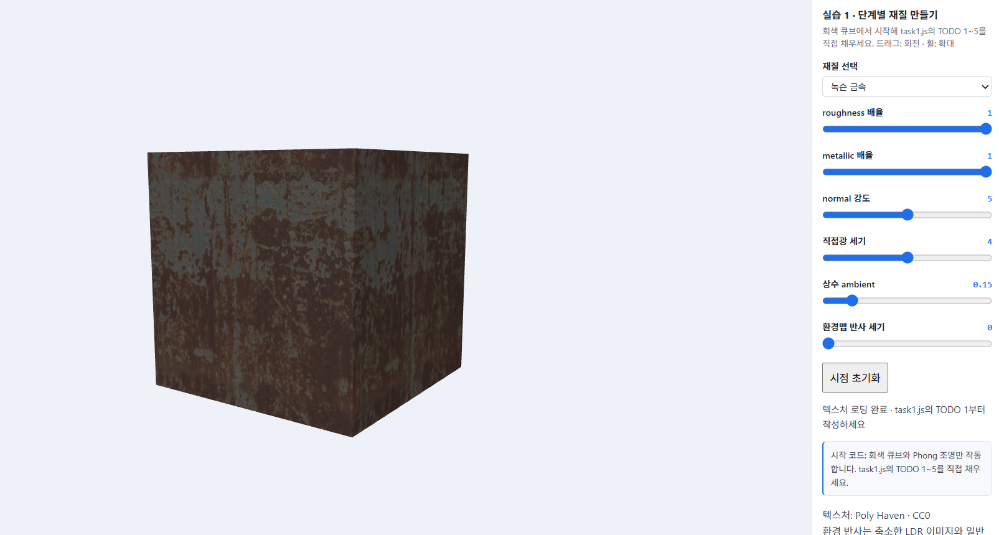
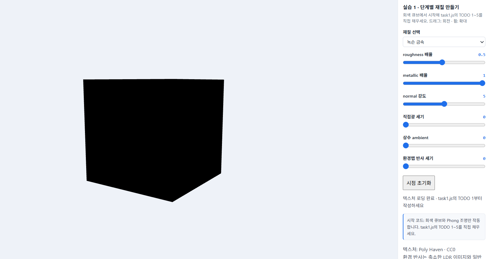
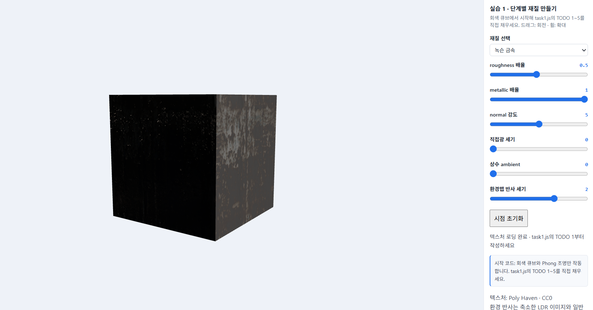
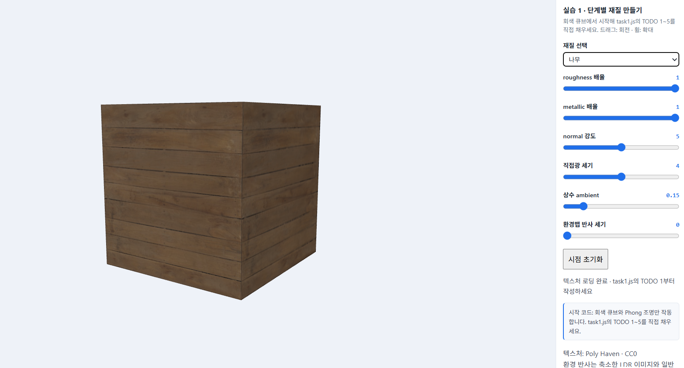
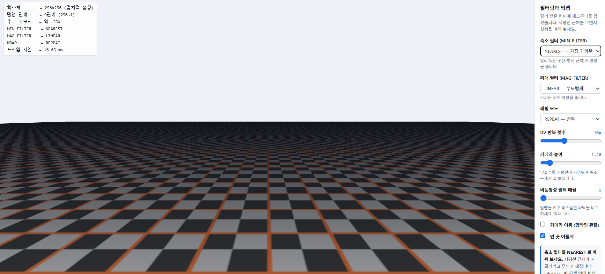
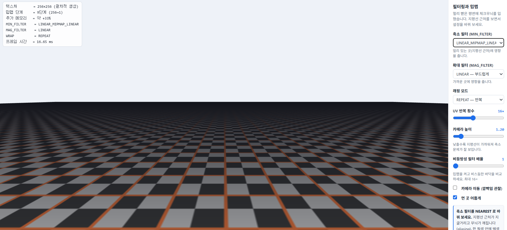

# 6주차 - PBR과 텍스처 매핑

- 이름: 장예령
- 저장소: https://github.com/yeryoung-jang/cg-2026-solar
- 실행: [Task 1](실행 링크) · [Task 2](실행 링크)

<br>

## Task 1 - PBR과 텍스처를 이용한 재질 구현

교수님이 제공한 시작 코드에서 TODO 1-5를 구현하여 같은 큐브에 나무, 금속, 돌의 재질을 적용했습니다.

Color Map으로 표면 색상을 표현하고 PBR 조명과 ARM Map, Normal Map, Enviroment Map을 순서대로 추가했습니다.

### 1. Color Map 적용

처음의 텍스처가 없는 회색 큐브 상태에서 UV 좌표를 이용해 색상 텍스처를 읽고 sRGB 색상을 선형 색 공간으로 변환하여 조명 계산에 사용했습니다.

```glsl
vec3 base=srgbToLinear(texture(uColor,vUV).rgb)*uTint;
```
적용 후에는 큐브 표면에 갈색 녹과 회색 금속 무늬가 나타났습니다. 큐브의 형태를 변경하지 않고 텍스처만으로 표면의 색상을 표현할 수 있었습니다.



### 2. PBR 조명 구현

기존 Phong 조명을 PBR 조명으로 변경하기 위해 `directPBR()` 함수를 구현했습니다.

PBR에서는 표면의 거칠기와 금속성 등을 고려하여 빛의 반사를 계산합니다.

- D (GGX): 표면의 거칠기에 따른 반사광의 분포
- F (Fresnel): 보는 각도에 따른 반사율
- G (Smith-Schlick): 표면의 미세한 굴곡으로 인해 빛이 가려지는 정도

```glsl
float D=a2/max(PI*d*d,1e-7);
vec3 F0=mix(vec3(0.04),base,metal);
vec3 F=F0+(1.0-F0)*pow(1.0-max(dot(H,V),0.0),5.0);

float k=(r+1.0)*(r+1.0)/8.0;
float G=(nv/(nv*(1.0-k)+k))*(nl/(nl*(1.0-k)+k));
```

계산한 D, F, G를 이용해 정반사와 확산 반사를 합산했습니다.

```glsl
vec3 specular=D*F*G/max(4.0*nv*nl,1e-6);
vec3 kd=(1.0-F)*(1.0-metal);

return (kd*base/PI+specular)*nl;
```

PBR 조명을 처음 적용했을 때는 기존보다 큐브가 전체적으로 어둡게 나타났습니다. 특히 금속 재질은 확산 반사 성분이 작고 환경맵도 아직 적용되지 않았기 때문에 표면이 어둡게 보였습니다. 이후 ARM Map과 환경 반사를 추가하면서 재질의 차이를 더 명확하게 확인할 수 있었습니다.

### 3. ARM Map 적용

ARM Map은 하나의 텍스처에 AO, Roughness, Metallic 정보를 RGB 채널로 저장한 맵입니다.

```glsl
vec3 arm=texture(uARM,vUV).rgb;
ao=arm.r;
rough=max(arm.g*uRough,0.045);
metal=arm.b*uMetal;
```

각 채널의 역할은 다음과 같습니다.

- R (AO): 간접광이 닿기 어려운 부분의 밝기 조절
- G (Roughness): 표면의 거칠기 조절
- B (Metallic): 금속성 조절



ARM Map을 적용하면 표면 전체에 동일한 재질 값을 사용하는 대신 위치마다 서로 다른 roughness와 metallic 값을 적용할 수 있습니다.

녹슨 금속에서는 갈색 녹이 발생한 부분과 회색 금속이 노출된 부분의 재질 특성이 다르게 표현됩니다.

**Metallic 배율 비교**

Metallic 배율을 1에서 0으로 낮추어 변화를 확인했습니다.



Metallic 배율을 0으로 변경하자 기존보다 큐브가 밝아지는 것을 확인했습니다.

금속 재질은 주로 정반사를 통해 빛을 표현하지만, metallic을 0으로 낮추면 비금속의 확산 반사 성분이 증가하기 때문입니다.

이를 통해 같은 색상 텍스처를 사용하더라도 metallic 값에 따라 표면의 밝기와 반사 특성이 달라진다는 것을 확인했습니다.

### 4. Normal Map 적용

Normal Map을 이용하여 실제 큐브의 형태를 변경하지 않고 표면의 작은 흠집과 굴곡을 표현했습니다.

텍스처에서 읽은 법선은 접선 공간을 기준으로 하기 때문에 TBN 행렬을 이용하여 조명 계산에 사용하는 좌표계로 변환했습니다.

```glsl
vec3 mapN=texture(uNormal,vUV).xyz*2.0-1.0;
mapN.xy *= uNormalStrength;
N=normalize(mat3(T*inv,B*inv,N)*normalize(mapN));
```

**Normal 강도 비교**

Normal 강도를 0과 5로 변경하여 같은 시점에서 비교했습니다.



처음에는 두 설정의 차이가 크게 느껴지지 않았지만 큐브를 확대하여 관찰하자 표면의 작은 명암 차이가 나타났습니다.

Normal Map은 실제 정점의 위치를 변경하는 것이 아니라 조명 계산에 사용하는 법선 방향만 변경합니다. 따라서 표면의 굴곡이 표현되더라도 큐브의 외곽선은 그대로 유지되었습니다.

### 5. Environment Map 적용

주변 환경이 물체 표면에 반사되도록 Environment Map을 추가했습니다.

카메라 방향과 표면 법선을 이용해 반사 방향을 계산하고, 해당 방향의 환경 이미지 색상을 읽도록 구현했습니다.

```glsl
vec3 reflected = reflect(-V,N);
vec2 envUV = vec2(atan(reflected.z,reflected.x)/(2.0*PI)+0.5,
                  asin(clamp(reflected.y,-1.0,1.0))/PI+0.5);
vec3 envColor = srgbToLinear(textureLod(uEnv,envUV,rough*7.0).rgb);
vec3 envF0 = mix(vec3(0.04),base,metal);
color += uEnvPower * ao * envColor * envF0;
```

**환경맵 반사 세기 비교**

환경맵의 영향만 확인하기 위해 직접광과 ambient를 모두 0으로 설정했습니다.

**환경맵 반사 세기 0**



모든 조명 성분을 0으로 설정하자 큐브가 검게 나타났습니다.

**환경맵 반사 세기 2**



환경맵 반사 세기를 높이자 직접광이 없는 상태에서도 큐브의 표면이 보였습니다.

이는 주변 환경 이미지에서 맑은 반사광이 표면 색상에 더해지기 때문입니다.

이번 비교를 통해 직접광과 ambient를 끄더라도 Environment Map이 적용되어 있으면 금속 표면에 반사광이 나타날 수 있다는 것을 확인했습니다.

### 6. 재질별 비교

같은 큐브에 나무, 금속, 돌의 텍스처를 적용하여 표면의 차이를 비교했습니다.

**나무 재질**



**돌 재질**


나무와 돌은 금속과 달리 metallic 값이 거의 0인 비금속 재질입니다.

나무는 목재 특유의 색상과 무늬가 나타났고, 돌은 암석 표면의 색상과 거친 질감이 표현되었습니다.

같은 메시를 사용하더라도 Color Map, Roughness, Metallic, Normal Map의 값에 따라 서로 다른 재질로 보인다는 것을 확인했습니다.

### 7. 텍스처 필터링 비교

교수님이 제공한 텍스처 필터링 예제에서 NEAREST와 LINEAR_MIPMAP_LINEAR의 차이를 비교했습니다.

**NEAREST 필터**



NEAREST는 가장 가까운 텍셀 하나의 값을 사용합니다. 따라서 텍스처가 축소될 때 무늬가 깨지거나 계단 현상이 나타나기 쉽습니다.

**LINEAR_MIPMAP_LINEAR 필터**



LINEAR_MIPMAP_LINEAR는 거리에 맞는 밉맵 단계와 주변 텍셀을 보간하여 색상을 계산합니다.

이 방식은 멀리 있는 텍스처의 무늬를 더 부드럽고 안정적으로 표현할 수 있습니다.

두 설정을 비교하면서 텍스처가 화면에서 작게 표시될 때는 밉맵을 이용한 필터링이 필요하다는 것을 알 수 있었습니다.

<br>

## Task 1 구현 과정에서 확인한 문제

이번 실습에서는 TODO를 순서대로 구현하면서 몇 가지 문제를 확인했습니다.

TODO 2에서 PBR 조명을 구현한 직후 큐브가 기존보다 어둡게 나타났습니다. 처음에는 조명 계산에 문제가 있는지 확인했지만, 금속 재질의 확산 반사 성분이 작고 아직 Environment Map이 적용되지 않은 상태라는 점을 확인했습니다.

TODO 3에서는 ARM Map 코드를 추가하는 과정에서 `rough`, `metal`, `ao` 변수 선언이 누락되어 셰이더 컴파일 오류가 발생했습니다.

기존 변수 선언을 다시 추가하여 문제를 해결했습니다.

```glsl
float rough=uRough,metal=uMetal,ao=1.0;
```

TODO 4에서는 Normal 강도를 변경해도 표면 차이가 크게 보이지 않았습니다. 이후 큐브를 확대하고 Normal 강도를 높여 관찰하면서 미세한 명암 변화를 확인했습니다.

또한 Color Map, ARM Map, Normal Map은 각각 다른 정보를 저장하므로 색상 텍스처에만 sRGB 변환을 적용하고, 수치 데이터인 ARM과 Normal Map에는 적용하지 않도록 구분했습니다.

<br>

## Task 1 AI 활용 사례

이번 실습에서는 ChatGPT를 활용하여 `task1.js`의 TODO 1~5 구현 방법을 확인하고 코드를 단계별로 수정했습니다.

기존 파일 구조를 유지하면서 각 TODO에 필요한 코드만 추가했으며, 수정할 때마다 브라우저에서 실행 결과를 확인했습니다.

특히 PBR 조명에서는 GGX, Fresnel, Smith-Schlick의 계산식을 함수에 적용하는 방법을 확인했습니다.

ARM Map을 적용한 뒤 변수 선언이 누락되어 발생한 셰이더 오류를 해결했고, Normal Map의 효과가 잘 보이지 않았을 때는 슬라이더 설정을 변경하여 실제 적용 여부를 확인했습니다.

또한 완성된 코드와 별도로 TODO 1만 구현한 파일을 임시로 만들어 단계별 비교 화면을 캡처했습니다. 캡처가 끝난 후에는 임시 파일을 삭제하고 최종 코드를 유지했습니다.

AI가 제안한 코드를 그대로 적용하는 것에서 끝내지 않고, 실행 화면과 슬라이더의 변화를 비교하면서 각 기능이 정상적으로 작동하는지 확인했습니다.

<br>

## Task 1 최종 정리 

이번 실습에서는 회색 큐브에 Color Map, PBR 조명, ARM Map, Normal Map, Environment Map을 순서대로 적용했습니다.

Color Map으로 표면의 색상을 표현하고, ARM Map을 이용해 위치마다 다른 거칠기와 금속성을 적용했습니다. Normal Map은 실제 형태를 변경하지 않고 표면의 미세한 굴곡을 표현하는 데 사용했습니다.

또한 Environment Map을 통해 직접광이 없는 상태에서도 주변 환경에 의한 반사광이 나타나는 것을 확인했습니다.

나무, 금속, 돌의 재질을 비교하면서 같은 형태의 물체라도 텍스처와 PBR 재질 값에 따라 서로 다르게 보일 수 있다는 것을 알게 되었습니다.

<br>

## Task 1 텍스처 출처 및 라이선스

교수님이 제공한 시작 코드의 Poly Haven 텍스처(Wood Planks, Rusty Metal 04, Rock Boulder Dry, Studio Small 09)를 사용했습니다.

모두 CC0 라이선스이며, 파일별 출처는 `assets/week06/sources.json`을 참고했습니다.