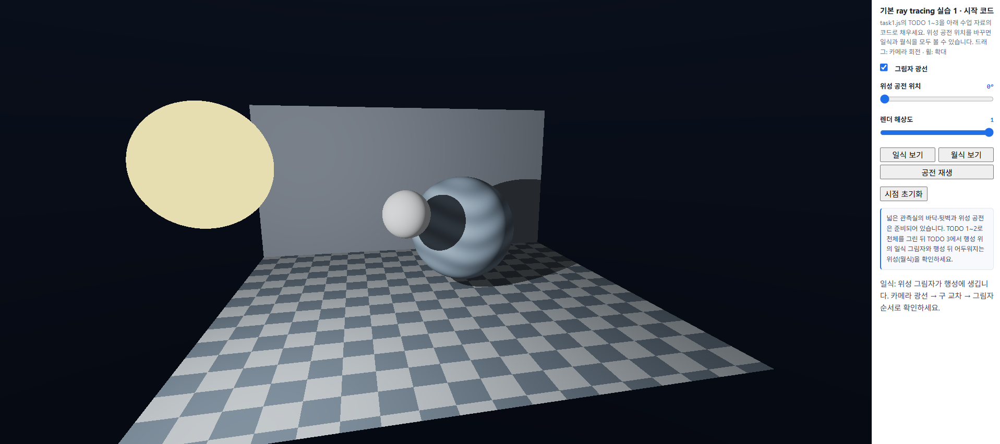
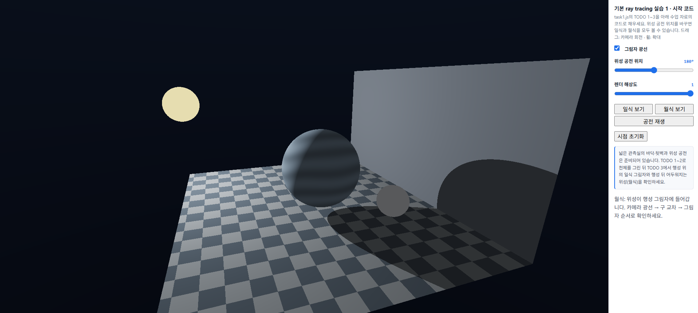
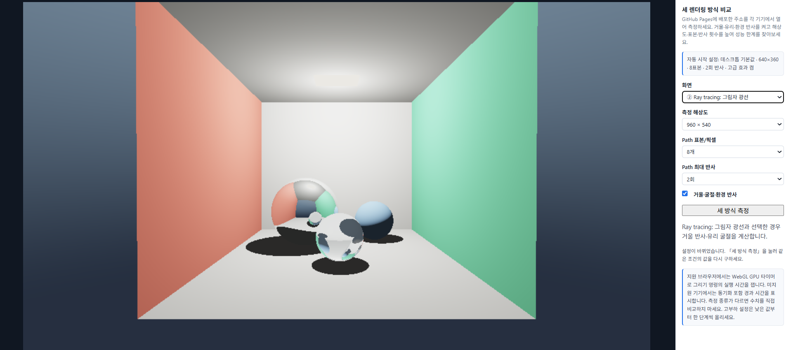
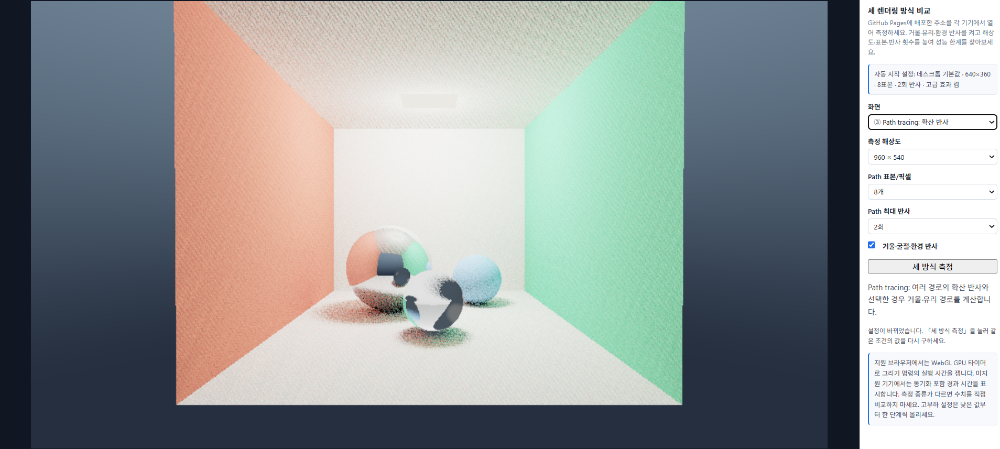
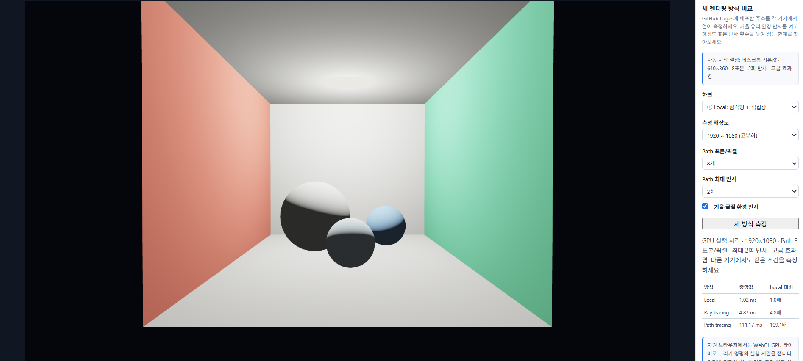
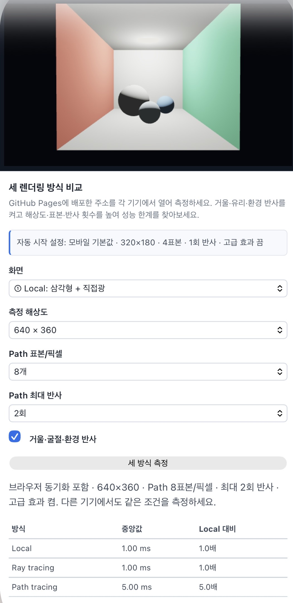
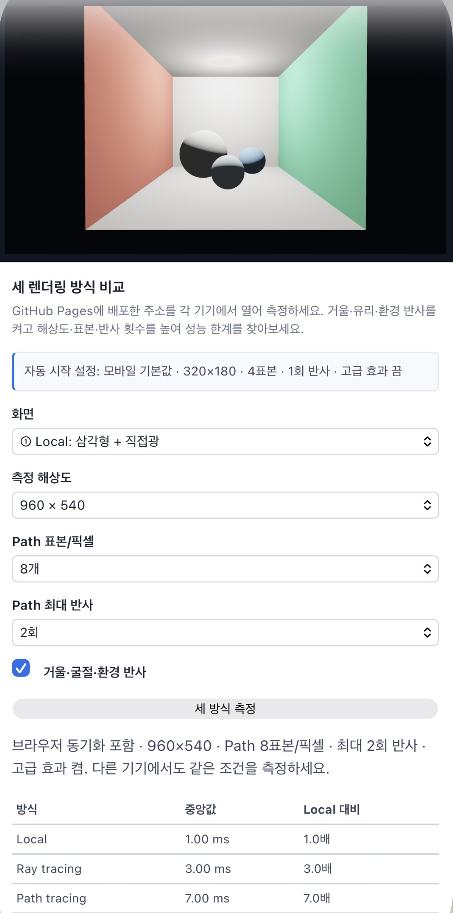
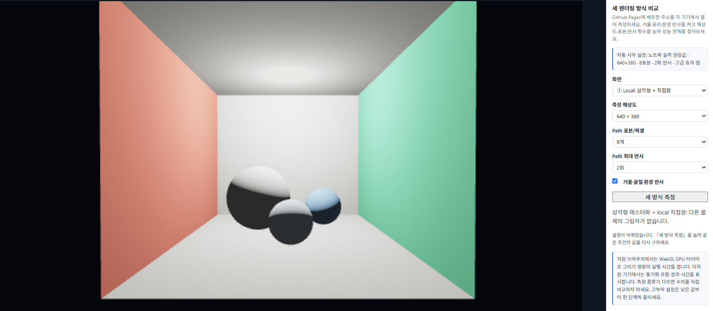
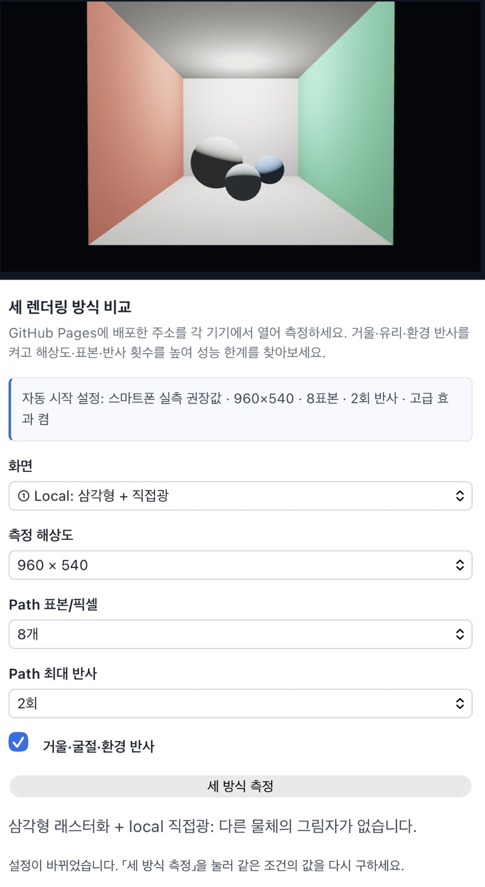

# 7주차 - 전역 조명과 Ray Tracing·Path Tracing

- 이름: 장예령
- 저장소: https://github.com/yeryoung-jang/cg-2026-solar
- 실행: [Task 1](https://yeryoung-jang.github.io/cg-2026-solar/week7/task1.html), [Task 2](https://yeryoung-jang.github.io/cg-2026-solar/week7/task2.html)

<br>

## Task 1 - 기본 Ray Tracing으로 일식·월식 구현

교수님이 제공한 시작 코드에서 TODO 1-3을 구현하여 Ray Tracing으로 별, 행성, 위성을 렌더링하고 일식과 월식 현상을 표현했습니다.

기존의 래스터화 방식과 달리 화면의 각 픽셀에서 광선을 생성하고 광선이 물체와 만나는 위치를 계산한 뒤 직접광과 그림자를 적용했습니다.

### 1. TODO 1 - 카메라 광선 생성

`cameraRay()` 함수를 구현하여 화면의 각 픽셀에서 출발하는 광선의 방향을 계산했습니다.

먼저 화면 픽셀 좌표를 카메라 중심 기준으로 변환하고, 카메라가 바라보는 방향인 `forward`, 오른쪽 방향인 `right`, 위쪽 방향인 `up`을 계산했습니다.

```glsl
vec2 uv=(2.0*pixel-uRes)/uRes.y;
vec3 target=vec3(0.0,0.0,-1.8);
vec3 forward=normalize(target-eye);
vec3 right=normalize(cross(forward,vec3(0.0,1.0,0.0)));
vec3 up=cross(right,forward);
return normalize(1.7*forward+uv.x*right+uv.y*up);
```

`uv`는 화면 중앙을 원점으로 하는 좌표이며, 세 방향 벡터를 조합하여 픽셀마다 서로 다른 광선 방향을 생성했습니다.

TODO 1 적용 전에는 화면이 회색으로 표시되었지만, 적용 후에는 체크무늬 바닥과 뒷벽이 원근감 있게 나타났습니다.

이를 통해 화면의 픽셀에서 3D 공간으로 광선을 보내는 과정이 정상적으로 구현되었음을 확인했습니다.

### 2. TODO 2 - 광선과 구의 교차 검사

`hitSphere()` 함수를 구현하여 카메라에서 출발한 광선이 구형 물체와 만나는지 계산했습니다.

광선의 시작점과 방향, 구의 중심과 반지름을 이용해 이차방정식을 구성하고 판별식으로 교차 여부를 확인했습니다.

```glsl
float disc=halfB*halfB-a*c;
if(disc<0.0)return -1.0;

float root=sqrt(disc);
float t=(-halfB-root)/a;
if(t>0.002)return t;

t=(-halfB+root)/a;
return t>0.002?t:-1.0;
```

판별식 `disc`가 음수이면 광선과 구가 만나지 않으므로 `-1.0`을 반환합니다.

교차점이 존재하는 경우 두 근을 검사하여 광선의 진행 방향에서 가장 가까운 유효한 교차 거리를 반환하도록 했습니다.

TODO 2를 적용한 뒤에는 기존의 바닥과 뒷벽에 더해 노란색 별, 푸른색 행성, 회색 위성이 화면에 나타났습니다.

이 단계에서는 아직 별빛이 다른 물체에 가려지는지 검사하지 않았으므로 일식과 월식에 해당하는 그림자는 나타나지 않았습니다.

### 3. TODO 3 - 직접광 및 그림자 계산

`shade()` 함수를 구현하여 물체 표면의 밝기와 그림자를 계산했습니다.

별은 자체적으로 빛나는 천체로 처리하고, 행성과 위성 및 바닥과 벽은 표면 법선과 별 방향을 이용하여 직접광을 계산했습니다.

```glsl
vec3 toStar=uBodies[0].xyz-p;
float lightDistance=length(toStar);
vec3 L=toStar/lightDistance;
```

`toStar`는 현재 표면 위치에서 별까지의 방향을 나타내며, `L`은 이를 정규화한 광원 방향입니다.

이후 표면에서 별을 향해 추가 광선을 보내고, 중간에 다른 물체가 있는지 검사하도록 했습니다.

```glsl
float visible=1.0;

if(uShadow==1){
  int blockerId;
  float blockerT=traceScene(p+N*0.004,L,blockerId);

  if(blockerId>0&&blockerT<lightDistance-0.004)
    visible=0.0;
}
```

`visible`은 별빛이 해당 표면에 도달할 수 있는지를 나타내는 값입니다.

표면과 별 사이에 다른 물체가 존재하면 `visible`을 0으로 변경하여 직접광이 적용되지 않도록 했습니다.

또한 `p+N*0.004`를 사용해 그림자 광선의 시작점을 표면에서 약간 이동시켰습니다. 이를 통해 광선이 자기 자신의 표면과 다시 교차하면서 잘못된 그림자를 생성하는 현상을 방지했습니다.

최종 표면 색상은 다음과 같이 계산했습니다.

```glsl
float diffuse=max(dot(N,L),0.0);
float power=4.0/(1.0+0.18*lightDistance*lightDistance);
float ambient=id==2?0.13:0.045;

return surfaceColor(id,p)*(ambient+visible*diffuse*power);
```

법선과 광원 방향의 내적을 이용하여 확산 반사를 계산하고 광원과의 거리에 따른 감쇠와 주변광을 함께 적용했습니다.

그림자가 생성된 영역에서는 직접광 성분이 제거되지만 주변광은 남아 있으므로 완전히 검게 표시되지 않을 수 있습니다.

<br>

### 4. 일식과 월식의 실행 결과

TODO 1-3을 구현한 뒤 위성의 공전 위치를 변경하여 일식과 월식이 정상적으로 표시되는지 확인했습니다.

#### 4-1. 일식 (위성 공전 위치 0°)

- 위성 공전 위치: 0°
- 그림자 광선: ON



공전 위치를 0°로 설정하면 별과 행성 사이에 위성이 위치합니다.

위성이 별빛의 일부를 가리면서 푸른 행성 표면에 검은 원형 그림자가 생성되는 것을 확인했습니다.

또한 관측실의 바닥과 뒷벽에도 물체에 의해 생성된 그림자가 나타났습니다. 

이를 통해 단순히 표면의 밝기를 계산하는 것뿐 아니라 광선이 다른 물체에 가려지는 상황도 표현할 수 있습니다.

#### 4-2. 월식 (위성 공전 위치 180°)

- 위성 공전 위치: 180°
- 그림자 광선: ON



공전 위치를 180°로 설정하면 행성이 별과 위성 사이에 위치합니다.

위성이 행성의 그림자 영역으로 이동하면서 밝기가 크게 감소하는 것을 확인했습니다.

위성은 주변광의 영향으로 완전히 사라지지는 않고 어두운 형태로 남아 있었습니다.

일식에서는 위성이 행성에 그림자를 만들고, 월식에서는 행성이 위성을 가리는 그림자를 만든다는 차이를 확인할 수 있었습니다. 

### 5. 그림자 광선 ON/OFF 비교 

실습 화면의 `그림자 광선` 체크박스를 이용하여 그림자 계산을 켰을 때와 껐을 때의 결과를 비교했습니다.

**그림자 광선 ON**

- 일식에서는 위성이 행성 표면에 만든 원형 그림자가 나타났습니다.
- 월식에서는 행성 뒤쪽에 위치한 위성이 어두워졌습니다.
- 바닥과 뒷벽에서도 물체에 의한 그림자를 확인할 수 있었습니다.

**그림자 광선 OFF**

- 일식에서는 행성 표면에 있던 검은 원형 그림자가 사라졌습니다.
- 월식에서는 행성에 가려져 어두웠던 위성이 이전보다 밝아졌습니다.
- 바닥과 뒷벽에서도 다른 물체에 의한 그림자 효과가 제거되었습니다.

그림자 광선을 끄더라도 표면 법선과 광원 방향에 따른 기본 명암 계산은 유지됩니다.

그러나 다른 물체가 광원을 가리는지 검사하지 않기 때문에 물체 사이의 그림자는 생성되지 않습니다.

이번 비교를 통해 Ray Tracing에서 그림자 광선은 **현재 표면과 광원 사이에 다른 물체가 존재하는지 확인하는 역할**을 한다는 것을 알 수 있었습니다.

<br>

## Task 1 구현 과정에서 확인한 사항

이번 실습에서는 TODO 1부터 TODO 3까지 순서대로 구현하고 각 단계에서 화면의 변화를 확인했습니다.

처음에는 모든 픽셀이 같은 방향의 광선을 사용하며 회색 화면만 나타났지만 TODO 1을 구현하자 바닥과 뒷벽이 나타났습니다.

TODO 2에서는 광선과 구의 교차 검사를 추가하여 별, 행성, 위성이 화면에 나타났습니다.

TODO 3에서는 표면의 직접광과 그림자 광선을 계산하여 일식과 월식에 따른 그림자가 표현되었습니다.

이후 `일식 보기`, `월식 보기` 버튼을 이용해 위성의 공전 위치를 변경하고 그림자 광선 체크박스를 켜고 끄면서 결과를 비교했습니다.

구현 과정에서 별도의 셰이더 컴파일 오류는 발생하지 않았으며, 세 단계 모두 예상한 실행 결과를 확인할 수 있었습니다.

<br>

## Task 1 AI 활용 사례

이번 실습에서는 ChatGPT를 활용하여 `task1.js`의 TODO 1~3에 필요한 코드를 확인하고, 각 함수의 역할을 이해하면서 단계별로 구현했습니다.

기존 파일 전체를 수정하지 않고 `cameraRay()`, `hitSphere()`, `shade()` 함수 내부의 TODO 부분만 순서대로 변경했습니다.

TODO 1에서는 화면 좌표와 카메라 방향 벡터를 이용해 광선을 생성하는 방법을 확인했습니다.

TODO 2에서는 광선과 구의 교차 여부를 판별식으로 판단하고, 가장 가까운 교차 거리를 구하는 방법을 확인했습니다.

TODO 3에서는 표면에서 광원 방향으로 그림자 광선을 보내 물체에 의한 가림 여부를 계산하는 방법을 확인했습니다.

각 TODO를 적용한 뒤에는 VS Code의 Live Server로 실행 화면을 확인하고, 예상한 결과와 비교했습니다.

마지막으로 일식과 월식 화면을 캡처하고, 그림자 광선을 켰을 때와 껐을 때 나타나는 차이를 확인했습니다.

AI의 도움으로 코드를 작성했지만 각 단계의 실행 결과를 직접 확인하면서 기능이 정상적으로 구현되었는지 검증했습니다.

<br>

## Task 1 최종 정리

이번 실습에서는 기본 Ray Tracing을 이용하여 화면의 픽셀에서 광선을 생성하고 3D 장면과의 교차점을 계산한 뒤 직접광과 그림자를 표현했습니다.

카메라 광선 생성, 광선과 구의 교차 검사, 그림자 광선 계산이라는 세 단계를 통해 별, 행성, 위성이 포함된 장면을 완성했습니다.

위성의 공전 위치를 0°와 180°로 변경하면서 각각 일식과 월식이 발생하는 과정을 확인했습니다.

또한 그림자 광선을 끄고 켜면서 표면의 기본 명암 계산과 다른 물체에 의한 가림 검사가 서로 다른 역할을 한다는 것을 알게 되었습니다.

이번 실습의 Ray Tracing은 카메라에서 출발한 광선과 직접광, 그림자 광선을 계산하는 방식이며, 여러 번의 간접 반사를 추적하는 Path Tracing과는 차이가 있습니다.

이를 통해 기존 래스터화 방식과 달리 화면의 픽셀에서 출발한 광선을 이용하여 3D 장면을 렌더링하는 과정을 이해할 수 있었습니다.

<br>

## Task 2 - 여러 기기에서 화질·성능을 측정하고 자동 설정하기

### 1. 실습 목적 및 측정 조건

Local Rendering, Ray Tracing, Path Tracing의 렌더링 성능을 비교하고 해상도·표본 수·반사 횟수에 따른 실행 시간 변화를 확인하였습니다.

또한 노트북과 스마트폰에서 동일한 조건으로 측정하여 기기별 성능 차이를 관찰하고 측정 결과를 바탕으로 초기 렌더링 설정을 자동으로 선택하는 기능을 구현하였습니다.

성능 비교를 위한 공통 측정 조건은 다음과 같습니다.

| 항목 | 설정값 |
|---|---|
| 측정 해상도 | 640 × 360 |
| Path 표본/픽셀 | 8개 |
| Path 최대 반사 | 2회 |
| 거울·굴절·환경 반사 | ON |
| 측정 횟수 | 기기별 3회 |
| 결과 정리 | 3회 측정의 중앙값 |

각 기기에서 동일한 조건으로 세 렌더링 방식을 측정하였으며 측정값의 변동을 고려하여 중앙값을 대표 결과로 사용했습니다.

<br>

### 2. 세 렌더링 방식의 화면 비교

노트북에서 세 가지 렌더링 방식을 실행하여 화면 차이를 확인했습니다.

**Local Rendering**

삼각형 래스터화와 직접광을 이용하여 장면을 렌더링합니다. 다른 물체에 의해 발생하는 그림자는 계산하지 않습니다.


**Ray Tracing**

광선과 물체의 교차를 검사하고 그림자 광선을 이용하여 물체 사이의 가려짐과 그림자를 계산합니다.



**Path Tracing**

여러 방향으로 표본 광선을 추적하여 간접광과 확산 반사를 계산합니다. 표본 수와 반사 횟수에 따라 계산량이 증가합니다.



세 방식은 동일한 장면을 렌더링하지만 광선을 계산하는 범위와 방식이 다르기 때문에 표현할 수 있는 조명 효과뿐 아니라 실행 시간에도 차이가 발생했습니다.

<br>

### 3. 노트북 성능 측정

#### 3-1. 기본 조건 측정

공통 측정 조건에서 세 렌더링 방식을 각각 3회 측정했습니다.

| 측정 | Local | Ray Tracing | Path Tracing |
|---|---:|---:|---:|
| 1회차 | 0.19 ms | 0.79 ms | 13.07 ms |
| 2회차 | 0.19 ms | 0.83 ms | 13.30 ms |
| 3회차 | 0.19 ms | 0.97 ms | 13.18 ms |
| **중앙값** | **0.19 ms** | **0.83 ms** | **13.18 ms** |

기본 조건에서 Local Rendering의 실행 시간이 가장 짧았고 Path Tracing의 실행 시간이 가장 길었습니다.

Path Tracing은 간접광 계산을 위해 여러 광선을 추가로 추적하므로 Local Rendering보다 많은 계산이 필요합니다.

#### 3-2. 해상도 변화

표본 수 8개, 최대 반사 2회, 고급 효과 ON을 유지하고 해상도를 높여 측정하였습니다.

| 해상도 | Local | Ray Tracing | Path Tracing |
|---|---:|---:|---:|
| 640 × 360 | 0.19 ms | 0.83 ms | 13.18 ms |
| 960 × 540 | 0.32 ms | 1.58 ms | 28.42 ms |
| 1280 × 720 | 0.51 ms | 2.15 ms | 50.14 ms |
| 1920 × 1080 | 1.02 ms | 4.87 ms | 111.17 ms |

해상도가 높아질수록 처리해야 할 픽셀 수가 증가하여 모든 방식의 실행 시간이 길어졌습니다.

특히 Path Tracing은 640×360에서 13.18ms였지만 1920×1080에서는 111.17ms로 증가하였습니다.

#### 3-3. 표본 수 및 반사 횟수 변화

해상도를 640×360으로 고정하고 Path Tracing의 표본 수와 최대 반사 횟수를 변경하였습니다.

| 변경 조건 | Path Tracing 측정 시간 |
|---|---:|
| 8표본 / 2회 반사 | 13.18 ms |
| 16표본 / 2회 반사 | 26.42 ms |
| 32표본 / 2회 반사 | 53.29 ms |
| 8표본 / 3회 반사 | 18.46 ms |
| 8표본 / 4회 반사 | 23.41 ms |

표본 수가 증가하면 픽셀마다 추적하는 광선이 많아지고 반사 횟수가 증가하면 광선의 추적 깊이가 커집니다.

실험 결과 두 설정 모두 Path Tracing의 실행 시간을 증가시키는 것을 확인했습니다.



<br>

### 4. 스마트폰 성능 측정 및 기기 비교

노트북과 동일한 GitHub Pages 주소를 스마트폰 브라우저에서 열어 측정했습니다.

#### 4-1. 스마트폰 기본 조건

노트북과 같은 640×360, 8표본, 2회 반사, 고급 효과 ON 조건에서 3회 측정했습니다.

| 측정 | Local | Ray Tracing | Path Tracing |
|---|---:|---:|---:|
| 1회차 | 1.00 ms | 1.00 ms | 5.00 ms |
| 2회차 | 1.00 ms | 2.00 ms | 4.00 ms |
| 3회차 | 1.00 ms | 2.00 ms | 6.00 ms |
| **중앙값** | **1.00 ms** | **2.00 ms** | **5.00 ms** |



#### 4-2. 스마트폰 고부하 조건

해상도만 960×540으로 높이고 나머지 조건은 동일하게 유지했습니다.

| 측정 | Local | Ray Tracing | Path Tracing |
|---|---:|---:|---:|
| 1회차 | 1.00 ms | 2.00 ms | 7.00 ms |
| 2회차 | 1.00 ms | 2.00 ms | 7.00 ms |
| 3회차 | 1.00 ms | 3.00 ms | 7.00 ms |
| **중앙값** | **1.00 ms** | **2.00 ms** | **7.00 ms** |



스마트폰에서도 해상도를 높였을 때 Path Tracing의 측정 시간이 5.00ms에서 7.00ms로 증가했습니다.

#### 4-3. 기기별 측정 결과 비교

| 기기 | 해상도 | Local | Ray Tracing | Path Tracing |
|---|---|---:|---:|---:|
| 노트북 | 640 × 360 | 0.19 ms | 0.83 ms | 13.18 ms |
| 스마트폰 | 640 × 360 | 1.00 ms | 2.00 ms | 5.00 ms |
| 노트북 | 960 × 540 | 0.32 ms | 1.58 ms | 28.42 ms |
| 스마트폰 | 960 × 540 | 1.00 ms | 2.00 ms | 7.00 ms |

이번 측정에서는 스마트폰의 Path Tracing 시간이 노트북보다 짧게 나타났습니다.

다만 브라우저와 운영체제에 따라 시간 측정 방식과 정밀도가 다를 수 있으므로 이 결과만으로 스마트폰의 그래픽 성능이 노트북보다 높다고 단정할 수는 없습니다.

두 기기 모두 해상도가 증가하면 Path Tracing의 실행 시간이 늘어난다는 공통적인 경향을 확인했습니다.

<br>

### 5. 기기별 초기 렌더링 설정 자동 선택

기본 시작 코드에서는 모바일 여부에 따라 미리 지정된 설정을 적용했습니다.

실제 측정 결과를 반영하기 위해 `task2.js`의 `chooseInitialProfile()` 함수를 수정하였습니다.

우선 한 프레임의 목표 렌더링 시간을 약 16.7ms로 설정하고 각 기기에서 측정한 Path Tracing 시간을 비교하여 초기 해상도를 결정하도록 했습니다.

주요 수정 코드는 다음과 같습니다.

```javascript
function chooseInitialProfile(){
  const mobile=navigator.userAgentData?.mobile || matchMedia('(pointer:coarse)').matches;

  const measured=mobile
    ? {'640':5.00,'960':7.00}
    : {'640':13.18,'960':28.42};

  const targetMs=16.7;
  const resolution=measured['960']<=targetMs?'960':'640';

  return {
    name:mobile?'스마트폰 실측 권장값':'노트북 실측 권장값',
    resolution:resolution,
    samples:'8',
    bounces:'2',
    advanced:true
  };
}
```

모바일 여부를 판별한 뒤 해당 기기 유형의 측정값을 사용하여 초기 설정을 선택합니다.

이는 실습에서 측정한 노트북과 스마트폰의 결과에 기반한 간단한 자동 선택 규칙이며, 모든 기기에서 성능을 실시간으로 측정하는 방식은 아닙니다.

수정 결과 자동 선택된 초기 설정은 다음과 같습니다.

| 항목 | 노트북 | 스마트폰 |
|---|---|---|
| 자동 설정 이름 | 노트북 실측 권장값 | 스마트폰 실측 권장값 |
| 해상도 | 640 × 360 | 960 × 540 |
| 표본/픽셀 | 8개 | 8개 |
| 최대 반사 | 2회 | 2회 |
| 고급 효과 | ON | ON |

**노트북 자동 설정 결과**



**스마트폰 자동 설정 결과**




각 기기에서 페이지를 실행했을 때 설정 이름과 해상도, 표본 수, 반사 횟수 및 고급 효과가 지정한 값으로 적용되는 것을 확인했습니다.

<br>

### 6. 최종 결과 및 확인한 사항

이번 실습을 통해 다음 사항을 확인했습니다.

1. Local Rendering, Ray Tracing, Path Tracing은 광선 계산 방식에 따라 화면 표현과 실행 시간이 달라진다.
2. 해상도와 표본 수, 반사 횟수가 증가하면 Path Tracing의 계산량과 실행 시간이 증가한다.
3. 실제 기기에서는 브라우저 환경과 측정 정밀도에 따라 실행 시간에 차이가 발생할 수 있다.
4. 노트북과 스마트폰에서 측정한 결과를 이용하여 기기 유형별 초기 렌더링 설정을 자동으로 선택할 수 있었다.

특히 단순히 높은 화질을 적용하는 것보다 실행 시간과 품질 사이의 균형을 고려하여 설정을 정하는 것이 중요하다는 점을 확인했습니다.

<br>

## Task 2 AI 활용 사례

이번 실습에서는 AI를 활용하여 성능 측정 순서를 정리하고 측정 결과를 분석한 뒤 자동 설정 코드를 수정했습니다.

- **측정 조건 설계:** AI의 도움으로 노트북과 스마트폰에서 동일한 기본 조건을 적용하고 해상도·표본 수·반사 횟수를 구분하여 측정했습니다.
- **결과 분석:** 각 조건의 측정값을 직접 확인하고 반복 측정 결과의 중앙값을 비교했습니다.
- **코드 수정:** AI가 제안한 `chooseInitialProfile()` 수정 방식을 참고하여 실제 측정값과 목표 렌더링 시간을 반영했습니다.
- **실행 검증:** 수정된 코드를 GitHub Pages에 반영한 뒤 노트북과 스마트폰에서 각각 실행하여 자동 설정이 정상적으로 적용되는지 확인했습니다.

<br>