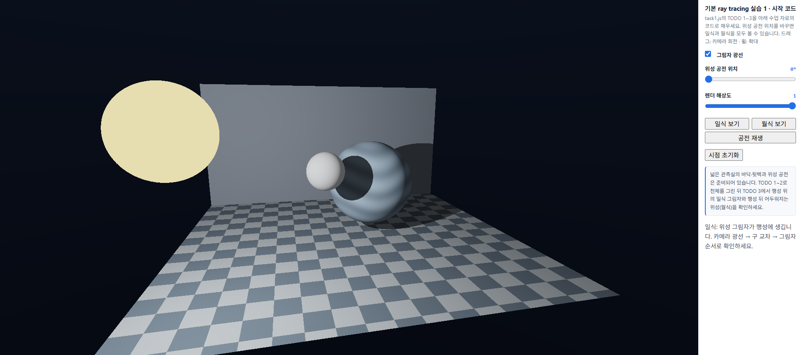
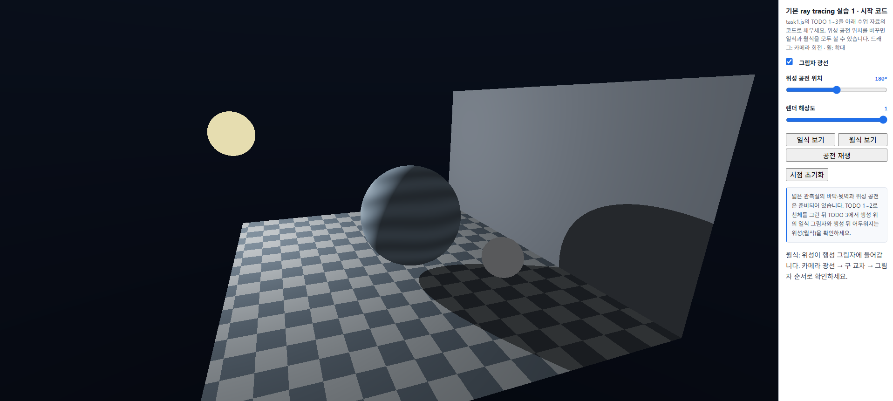

# 7주차 - 전역 조명과 Ray Tracing·Path Tracing

- 이름: 장예령
- 저장소: https://github.com/yeryoung-jang/cg-2026-solar
- 실행: [Task 1](https://yeryoung-jang.github.io/cg-2026-solar/week7/task1.html)

<br>

## Task 1 - 기본 Ray Tracing으로 일식·월식 구현

교수님이 제공한 시작 코드에서 TODO 1-3을 구현하여 Ray Tracing으로 별, 행성, 위성을 렌더링하고 일식과 월식 현상을 표현했습니다.

기존의 래스터화 방식과 달리 화면의 각 픽셀에서 광선을 생성하고 광선이 물체와 만나는 위치를 계산한 뒤 직접광과 그림자를 적용했습니다.

### 1. TODO 1 - 카메라 광성 생성

`cameraRay()` 함수를 구현하여 화면의 각 픽셀에서 출발하는 광선의 방향을 계산했습니다.

먼저 화면 픽셀 좌표를 카메라 중심 기준으로 변환하고, 카메라가 바라보는 방향인 `forward`, 오른쪽 방향인 `right`, 위쪽 방향인 `up`을 계산했습니다.

```glsl
vec2 uv=(2.0*pixel-uRes)/uRes.y;
vec3 target=vec3(0.0,0.0,-1.8);
vec3 forward=normalize(target-eye);
vec3 right=normalize(cross(forward,vec3(0.0,1.0,0.0)));
vec3 up=cross(right,forward);
return normalize(1.7*forward+uv.x*right+uv.y*up);
```

`uv`는 화면 중앙을 원점으로 하는 좌표이며, 세 방향 벡터를 조합하여 픽셀마다 서로 다른 광선 방향을 생성했습니다.

TODO 1 적용 전에는 화면이 회색으로 표시되었지만, 적용 후에는 체크무늬 바닥과 뒷벽이 원근감 있게 나타났습니다.

이를 통해 화면의 픽셀에서 3D 공간으로 광선을 보내는 과정이 정상적으로 구현되었음을 확인했습니다.

### 2. TODO 2 - 광선과 구의 교차 검사

`hitSphere()` 함수를 구현하여 카메라에서 출발한 광선이 구형 물체와 만나는지 계산했습니다.

광선의 시작점과 방향, 구의 중심과 반지름을 이용해 이차방정식을 구성하고 판별식으로 교차 여부를 확인했습니다.

```glsl
float disc=halfB*halfB-a*c;
if(disc<0.0)return -1.0;

float root=sqrt(disc);
float t=(-halfB-root)/a;
if(t>0.002)return t;

t=(-halfB+root)/a;
return t>0.002?t:-1.0;
```

판별식 `disc`가 음수이면 광선과 구가 만나지 않으므로 `-1.0`을 반환합니다.

교차점이 존재하는 경우 두 근을 검사하여 광선의 진행 방향에서 가장 가까운 유효한 교차 거리를 반환하도록 했습니다.

TODO 2를 적용한 뒤에는 기존의 바닥과 뒷벽에 더해 노란색 별, 푸른색 행성, 회색 위성이 화면에 나타났습니다.

이 단계에서는 아직 별빛이 다른 물체에 가려지는지 검사하지 않았으므로 일식과 월식에 해당하는 그림자는 나타나지 않았습니다.

### 3. TODO 3 - 직접광 및 그림자 계산

`shade()` 함수를 구현하여 물체 표면의 밝기와 그림자를 계산했습니다.

별은 자체적으로 빛나는 천체로 처리하고, 행성과 위성 및 바닥과 벽은 표면 법선과 별 방향을 이용하여 직접광을 계산했습니다.

```glsl
vec3 toStar=uBodies[0].xyz-p;
float lightDistance=length(toStar);
vec3 L=toStar/lightDistance;
```

`toStar`는 현재 표면 위치에서 별까지의 방향을 나타내며, `L`은 이를 정규화한 광원 방향입니다.

이후 표면에서 별을 향해 추가 광선을 보내고, 중간에 다른 물체가 있는지 검사하도록 했습니다.

```glsl
float visible=1.0;

if(uShadow==1){
  int blockerId;
  float blockerT=traceScene(p+N*0.004,L,blockerId);

  if(blockerId>0&&blockerT<lightDistance-0.004)
    visible=0.0;
}
```

`visible`은 별빛이 해당 표면에 도달할 수 있는지를 나타내는 값입니다.

표면과 별 사이에 다른 물체가 존재하면 `visible`을 0으로 변경하여 직접광이 적용되지 않도록 했습니다.

또한 `p+N*0.004`를 사용해 그림자 광선의 시작점을 표면에서 약간 이동시켰습니다. 이를 통해 광선이 자기 자신의 표면과 다시 교차하면서 잘못된 그림자를 생성하는 현상을 방지했습니다.

최종 표면 색상은 다음과 같이 계산했습니다.

```glsl
float diffuse=max(dot(N,L),0.0);
float power=4.0/(1.0+0.18*lightDistance*lightDistance);
float ambient=id==2?0.13:0.045;

return surfaceColor(id,p)*(ambient+visible*diffuse*power);
```

법선과 광원 방향의 내적을 이용하여 확산 반사를 계산하고 광원과의 거리에 따른 감쇠와 주변광을 함께 적용했습니다.

그림자가 생성된 영역에서는 직접광 성분이 제거되지만 주변광은 남아 있으므로 완전히 검게 표시되지 않을 수 있습니다.

<br>

### 4. 일식과 월식의 실행 결과

TODO 1-3을 구현한 뒤 위성의 공전 위치를 변경하여 일식과 월식이 정상적으로 표시되는지 확인했습니다.

#### 4-1. 일식 (위성 공전 위치 0°)

- 위성 공전 위치: 0°
- 그림자 광선: ON



공전 위치를 0°로 설정하면 별과 행성 사이에 위성이 위치합니다.

위성이 별빛의 일부를 가리면서 푸른 행성 표면에 검은 원형 그림자가 생성되는 것을 확인했습니다.

또한 관측실의 바닥과 뒷벽에도 물체에 의해 생성된 그림자가 나타났습니다. 

이를 통해 단순히 표면의 밝기를 계산하는 것뿐 아니라 광선이 다른 물체에 가려지는 상황도 표현할 수 있습니다.

#### 4-2 월식 (위성 공전 위치 180°)

- 위성 공전 위치: 180°
- 그림자 광선: ON



공전 위치를 180°로 설정하면 행성이 별과 위성 사이에 위치합니다.

위성이 행성의 그림자 영역으로 이동하면서 밝기가 크게 감소하는 것을 확인했습니다.

위성은 주변광의 영향으로 완전히 사라지지는 않고 어두운 형태로 남아있었습니다.

일식에서는 위성이 행성에 그림자를 만들고, 월식에서는 행성이 위성을 가리는 그림자를 만든다는 차이를 확인할 수 있었습니다. 

### 5. 그림자 광선 ON/OFF 비교 

실습 화면의 `그림자 광선` 체크박스를 이용하여 그림자 계산을 켰을 때와 껐을 때의 결과를 비교했습니다.

**그림자 광선 ON**

- 일식에서는 위성이 행성 표면에 만든 원형 그림자가 나타났습니다.
- 월식에서는 행성 뒤쪽에 위치한 위성이 어두워졌습니다.
- 바닥과 뒷벽에서도 물체에 의한 그림자를 확인할 수 있었습니다.

**그림자 광선 OFF**

- 일식에서는 행성 표면에 있던 검은 원형 그림자가 사라졌습니다.
- 월식에서는 행성에 가려져 어두웠던 위성이 이전보다 밝아졌습니다.
- 바닥과 뒷벽에서도 다른 물체에 의한 그림자 효과가 제거되었습니다.

그림자 광선을 끄더라도 표면 법선과 광원 방향에 따른 기본 명암 계산은 유지됩니다.

그러나 다른 물체가 광원을 가리는지 검사하지 않기 때문에 물체 사이의 그림자는 생성되지 않습니다.

이번 비교를 통해 Ray Tracing에서 그림자 광선은 **현재 표면과 광원 사이에 다른 물체가 존재하는지 확인하는 역할**을 한다는 것을 알 수 있었습니다.

<br>

## Task 1 구현 과정에서 확인한 사항

이번 실습에서는 TODO 1부터 TODO 3까지 순서대로 구현하고 각 단계에서 화면의 변화를 확인했습니다.

처음에는 모든 픽셀이 같은 방향의 광선을 사용하며 회색 화면만 나타났지만 TODO 1을 구현하자 바닥과 뒷벽이 나타났습니다.

TODO 2에서는 광선과 구의 교차 검사를 추가하여 별, 행성, 위성이 화면에 나타났습니다.

TODO 3에서는 표면의 직접광과 그림자 광선을 계산하여 일식과 월식에 따른 그림자가 표현되었습니다.

이후 `일식 보기`, `월식 보기` 버튼을 이용해 위성의 공전 위치를 변경하고 그림자 광선 체크박스를 켜고 끄면서 결과를 비교했습니다.

구현 과정에서 별도의 셰이더 컴파일 오류는 발생하지 않았으며, 세 단계 모두 예상한 실행 결과를 확인할 수 있었습니다.

<br>

## Task 1 AI 활용 사례

이번 실습에서는 ChatGPT를 활용하여 `task1.js`의 TODO 1~3에 필요한 코드를 확인하고, 각 함수의 역할을 이해하면서 단계별로 구현했습니다.

기존 파일 전체를 수정하지 않고 `cameraRay()`, `hitSphere()`, `shade()` 함수 내부의 TODO 부분만 순서대로 변경했습니다.

TODO 1에서는 화면 좌표와 카메라 방향 벡터를 이용해 광선을 생성하는 방법을 확인했습니다.

TODO 2에서는 광선과 구의 교차 여부를 판별식으로 판단하고, 가장 가까운 교차 거리를 구하는 방법을 확인했습니다.

TODO 3에서는 표면에서 광원 방향으로 그림자 광선을 보내 물체에 의한 가림 여부를 계산하는 방법을 확인했습니다.

각 TODO를 적용한 뒤에는 VS Code의 Live Server로 실행 화면을 확인하고, 예상한 결과와 비교했습니다.

마지막으로 일식과 월식 화면을 캡처하고, 그림자 광선을 켰을 때와 껐을 때 나타나는 차이를 확인했습니다.

AI의 도움으로 코드를 작성했지만 각 단계의 실행 결과를 직접 확인하면서 기능이 정상적으로 구현되었는지 검증했습니다.

<br>

## Task 1 최종 정리

이번 실습에서는 기본 Ray Tracing을 이용하여 화면의 픽셀에서 광선을 생성하고 3D 장면과의 교차점을 계산한 뒤 직접광과 그림자를 표현했습니다.

카메라 광선 생성, 광선과 구의 교차 검사, 그림자 광선 계산이라는 세 단계를 통해 별, 행성, 위성이 포함된 장면을 완성했습니다.

위성의 공전 위치를 0°와 180°로 변경하면서 각각 일식과 월식이 발생하는 과정을 확인했습니다.

또한 그림자 광선을 끄고 켜면서 표면의 기본 명암 계산과 다른 물체에 의한 가림 검사가 서로 다른 역할을 한다는 것을 알게 되었습니다.

이번 실습의 Ray Tracing은 카메라에서 출발한 광선과 직접광, 그림자 광선을 계산하는 방식이며, 여러 번의 간접 반사를 추적하는 Path Tracing과는 차이가 있습니다.

이를 통해 기존 래스터화 방식과 달리 화면의 픽셀에서 출발한 광선을 이용하여 3D 장면을 렌더링하는 과정을 이해할 수 있었습니다.

<br>

